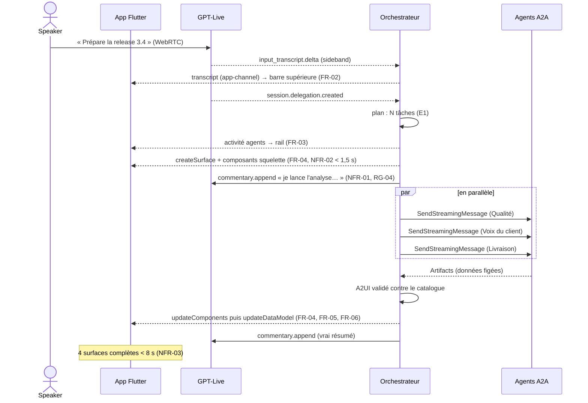
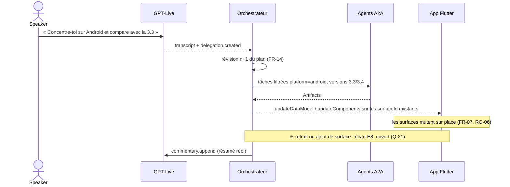
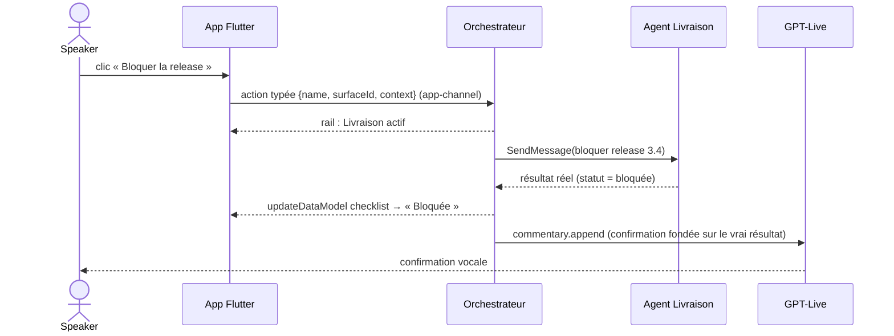
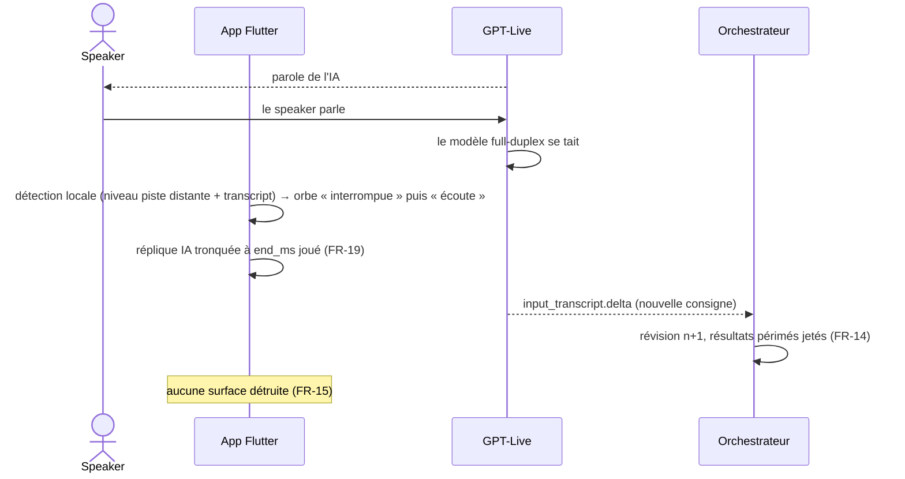
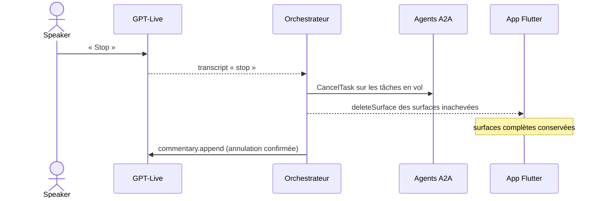

# Agents, protocoles et séquences des actes

**En bref.** La voix circule en WebRTC entre l'app et GPT-Live ; le backend écoute la même session en sideband et reçoit la délégation ; il délègue aux agents en A2A ; l'UI revient à l'app en messages A2UI sur un canal séparé (proposé : WSS maison ; alternative `genui_a2a`, ouvert → Q-39), et les clics repartent par le même canal. Ce document donne les séquences des 3 actes ([pdr-0004](../decisions/pdr-0004-mvp-three-acts.md)), de l'interruption et de « Stop ».

> Statut : **draft**. Les séquences sont la proposition de l'assistant, construites sur les faits de la base `knowledge/`. Version A2UI : v0.9 ([pdr-0018](../decisions/pdr-0018-a2ui-v09-genui-0-10-4.md)). Producteur de l'A2UI : chaque agent A2A, l'orchestrateur valide et relaie ([pdr-0036](../decisions/pdr-0036-real-a2a-agents-produce-a2ui.md), Q-37). Choix encore ouvert : canal app ↔ backend (Q-39).

## Qui parle à qui, avec quoi

| De → vers | Protocole | Contenu | Source |
|---|---|---|---|
| App ↔ GPT-Live | **WebRTC** (média + DataChannel `oai-events`) | voix du speaker, voix de l'IA | [rt-gpt-live-webrtc-session] |
| App → backend | **HTTPS** `POST /voice/sessions` | offre SDP → answer SDP | [rt-ephemeral-keys] |
| Backend ↔ GPT-Live | **REST** + **sideband WSS** `/live/sessions/{id}/attach` | transcripts, `delegation.created`, `commentary/thinking.append`, `close` | [rt-gpt-live-sideband] |
| Orchestrateur ↔ agents | **A2A v1.0** (JSON-RPC + SSE) | tâches, statut, Artifacts | [proto-a2a-task-lifecycle], [proto-a2a-streaming-push] |
| Backend → app | **WSS app-channel** maison ([pdr-0045](../decisions/pdr-0045-app-backend-channel-wss-recommended.md)) | messages **A2UI** v0.9 ([pdr-0018](../decisions/pdr-0018-a2ui-v09-genui-0-10-4.md)), activité des agents, transcript, état orbe | [ma-backend-stack-recommendation] |
| App → backend | **WSS app-channel** | actions utilisateur typées (`UiInteractionPart`) | [genui-user-actions] |

Règles : l'A2UI ne passe **jamais** par le canal de la session voix ([genui-a2ui-transports]) ; le JSON A2UI n'est jamais lu à voix haute ([ma-target-architecture]). Le canal est un **WSS maison** ; `genui_a2a` (A2A + SSE) n'entre pas dans la stack de l'app ([pdr-0045](../decisions/pdr-0045-app-backend-channel-wss-recommended.md), acceptée, Q-39). Pour mémoire, compatibilité vérifiée en SP-03 (2026-10-29) : `genui_a2a` appelle `message/stream` (A2A v0.3) ; `a2a-go` v2 doit monter le handler `a2acompat/a2av0` (le handler natif v1.0 répond `-32009`) ([proto-a2a-go-v03-compat], [genui-a2a-connector]).

## Acte 1 — Créer (FR-01 à FR-06)

## Acte 2 — Transformer (FR-07)

## Acte 3 — Interagir (FR-08)

La confirmation vocale ne part qu'**après** le résultat réel ([ma-real-tool-results]).

## Interruption (barge-in, FR-13, FR-14, FR-15, FR-19)

⚠️ GPT-Live n'expose **aucun événement d'interruption** ([rt-barge-in], [rt-gpt-live-lifecycle]) : l'état « Interrompue » de l'orbe doit être **inféré** côté app. Méthode à valider par spike (voir Points ouverts). Mesuré en SP-02 (2026-10-29) : l'IA se tait dans le bloc de 200 ms du premier mot d'interruption (essai automatisé) ; essai réel dans un navigateur (AEC activée, enceintes du PC) : coupure nette, puis 60 s de parole continue sans auto-interruption ([rt-barge-in], [rt-gpt-live-lifecycle]) ; flutter_webrtc sous Linux et sono de la salle non testés. Le raccourci « silence » (FR-20) est le secours.

## « Stop » / « annule » (FR-16)

Interrompre la parole **n'annule pas** le travail backend : l'orchestrateur annule explicitement, confirme, puis seulement annonce ([rt-gpt-live-delegation]). Le mode de détection de « stop » reste ouvert (Q-42) ; le raccourci « silence » ne coupe que la voix.

## Écarts entre sources (laissés ouverts)

Effets techniques des écarts de [p-fn-mockups](../functional/mockups.md) (E1 à E22), sans arbitrage :
- **E3 · Q-03** version A2UI — **tranchée** par [pdr-0018](../decisions/pdr-0018-a2ui-v09-genui-0-10-4.md) (décision contrainte) : v0.9 (`createSurface`, `updateComponents`, `updateDataModel`, `deleteSurface`, `"version": "v0.9"`), genui 0.10.4 ([genui-a2ui-messages], [genui-a2ui-overview]). La mention v0.8 de l'illustration est sans portée ([pdr-0017](../decisions/pdr-0017-source-hierarchy-sheet-over-mockups.md)).
- **E1 · Q-01 tranché** ([pdr-0013](../decisions/pdr-0013-orchestrator-visible-agent-selection.md)) : l'orchestrateur sélectionne un sous-ensemble d'agents par demande et le rail montre actifs / en veille ; nombre d'Agent Cards libre, noms métier. **E9 · Q-22** actes vs étapes : marqueurs du journal. **E11 · Q-29 tranché** ([pdr-0015](../decisions/pdr-0015-app-held-canvas-layout.md)) : N surfaces `s-*`, mises en page par l'app, pas de racine `Grid`. **E2 · Q-02 tranché** ([pdr-0014](../decisions/pdr-0014-six-component-catalog.md)) : 6 composants ; l'acte 2 procède par mutation des surfaces existantes (`updateComponents` / `updateDataModel`), sans Comparatif de versions ni Timeline. **E22 · Q-64 tranché** ([pdr-0026](../decisions/pdr-0026-desktop-only-target.md)) : desktop seul ([pdr-0002](../decisions/pdr-0002-desktop-platform.md)) ; les ADR hérités orientés web ne changent pas la cible ; effets sur le DS et l'a11y dans [p-ar-frontend](frontend.md).
- **E7 / E8 · Q-20, Q-21** transformation : si Q-21 autorise la suppression, l'acte 2 émettrait `deleteSurface` / `createSurface` en plus des mutations ; sinon, mutations seules (fiche § 4, RG-06).

## Points ouverts (registre : [p-rm-open-questions](../roadmap/open-questions.md))

- ~~Canal app ↔ backend~~ : tranché, WSS maison ; `genui_a2a` hors stack de l'app ; le panneau protocole (FR-05) accède aux messages bruts de l'app-channel ([pdr-0045](../decisions/pdr-0045-app-backend-channel-wss-recommended.md), Q-39).
- **Inférence de l'interruption** pour FR-19 sans événement GPT-Live → Q-40. **Bruits courts** (FR-18, RG-16) : aucun réglage de détection de tour documenté pour GPT-Live ; à mesurer → Q-41.
- **Détection de « Stop »** : mot-clé sur transcript côté orchestrateur, ou décision du modèle → Q-42. **Agents A2A réels**, processus séparés : tranché ([pdr-0036](../decisions/pdr-0036-real-a2a-agents-produce-a2ui.md), Q-16) ; pas d'agent d'un autre éditeur ([pdr-0035](../decisions/pdr-0035-no-third-party-agent.md), Q-10).
