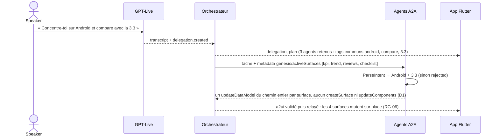
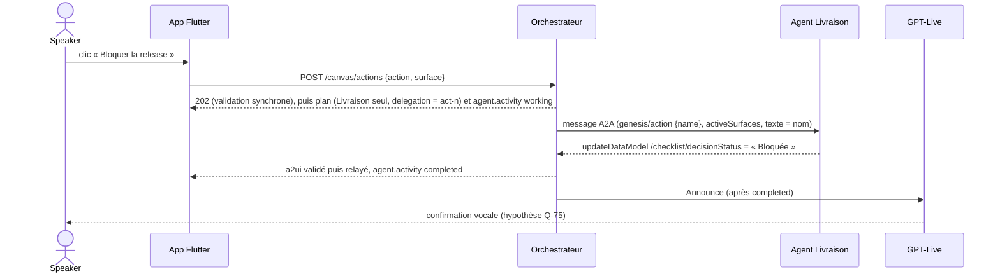

# Agents, protocoles et séquences des actes

**En bref.** La voix circule en WebRTC entre l'app et GPT-Live ; le backend écoute la même session en sideband et reçoit la délégation ; il délègue aux agents en A2A ; l'UI revient à l'app en messages A2UI sur un canal séparé (proposé : WSS maison ; alternative `genui_a2a`, ouvert → Q-39), et les clics repartent par le même canal. Ce document donne les séquences des 3 actes ([pdr-0004](../decisions/pdr-0004-mvp-three-acts.md)), de l'interruption et de « Stop ».

> Statut : **draft**. Le contrat app-channel / API v1 est **implémenté** (fonctionnalités 003, 004, 006 et 007, [p-ar-app-channel-contract](app-channel-contract.md)). Les séquences sont la proposition de l'assistant, construites sur les faits de la base `knowledge/`. Version A2UI : v0.9 ([pdr-0018](../decisions/pdr-0018-a2ui-v09-genui-0-10-4.md)). Producteur de l'A2UI : chaque agent A2A, l'orchestrateur valide et relaie ([pdr-0036](../decisions/pdr-0036-real-a2a-agents-produce-a2ui.md), Q-37). Canal app ↔ backend : WSS maison (Q-39 tranchée).

## Qui parle à qui, avec quoi

| De → vers | Protocole | Contenu | Source |
|---|---|---|---|
| App ↔ GPT-Live | **WebRTC** (média + DataChannel `oai-events`) | voix du speaker, voix de l'IA | [rt-gpt-live-webrtc-session] |
| App → backend | **HTTPS** `POST /voice/sessions` ; `POST /canvas/reset` (007) ; `POST /canvas/actions` (009) | offre SDP → answer SDP ; remise à vide du canevas (`{}` en JSON, 204) ; clic sur un composant (`{action, surface}`, 202) | [rt-ephemeral-keys], [genui-user-actions] |
| Backend ↔ GPT-Live | **REST** + **sideband WSS** `/live/sessions/{id}/attach` | transcripts, `delegation.created`, `commentary/thinking.append`, `close` | [rt-gpt-live-sideband] |
| Orchestrateur ↔ agents | **A2A v1.0** (JSON-RPC + SSE) | tâches, statut, Artifacts ; cartes avec `skills[].tags` et `examples` (006) ; clé de metadata `genesis/activeSurfaces` (surfaces actives de l'agent) | [proto-a2a-task-lifecycle], [proto-a2a-streaming-push], [proto-a2a-agent-card] |
| Backend → app | **WSS app-channel** maison ([pdr-0045](../decisions/pdr-0045-app-backend-channel-wss-recommended.md)) | messages **A2UI** v0.9 ([pdr-0018](../decisions/pdr-0018-a2ui-v09-genui-0-10-4.md)), activité des agents, transcript, état orbe | [ma-backend-stack-recommendation] |

Règles : l'A2UI ne passe **jamais** par le canal de la session voix ([genui-a2ui-transports]) ; le JSON A2UI n'est jamais lu à voix haute ([ma-target-architecture]). Le canal est un **WSS maison** ; `genui_a2a` (A2A + SSE) n'entre pas dans la stack de l'app ([pdr-0045](../decisions/pdr-0045-app-backend-channel-wss-recommended.md), acceptée, Q-39) ; le panneau protocole (FR-05) lit les messages bruts de l'app-channel. Le canal WSS reste **descendant** : les clics repartent en HTTP (`POST /canvas/actions`, accusé synchrone), pas par une écoute montante ([pdr-0065](../decisions/pdr-0065-009-act3-interact-details-assistant-decided.md) D1). Pour mémoire, compatibilité vérifiée en SP-03 (2026-10-29) : `genui_a2a` appelle `message/stream` (A2A v0.3) ; `a2a-go` v2 doit monter le handler `a2acompat/a2av0` (le handler natif v1.0 répond `-32009`) ([proto-a2a-go-v03-compat], [genui-a2a-connector]).

## Acte 1 — Créer (FR-01 à FR-06)

```mermaid
sequenceDiagram
  actor S as Speaker
  participant App as App Flutter
  participant L as GPT-Live
  participant O as Orchestrateur
  participant Ag as Agents A2A
  S->>L: « Prépare la release 3.4 » (WebRTC)
  L-->>O: input_transcript.delta (sideband) → transcript à l'app (FR-02)
  L-->>O: session.delegation.created
  O-->>App: delegation {id, offset_ms}
  O-->>App: plan {delegation, selected[], idle[]} (cartes lues une fois, tags des skills ; avant toute activité)
  O->>L: commentary.append générique « je lance l'analyse… » (NFR-01, RG-04)
  par en parallèle, un agent par agent retenu (E1)
    O->>Ag: SendStreamingMessage (Qualité, Voix du client, Livraison) + metadata genesis/activeSurfaces
  end
  Ag-->>O: submitted → agent.activity working (rail, FR-03)
  Ag-->>O: message A2UI : createSurface + squelette (NFR-02 < 1,5 s)
  O-->>App: a2ui validé puis relayé tel quel (FR-04, FR-05, FR-06)
  Ag-->>O: updateComponents, updateDataModel, résumé, completed
  O-->>App: a2ui relayés puis agent.activity completed
  O->>L: commentary.append (vrai résumé de l'agent)
  Note over App: 4 surfaces complètes < 8 s (NFR-03)
```

**Implémenté (006)** : « Prépare la release 3.4 » retient les trois agents et produit 4 surfaces en trois temps ; une demande précise (« les avis ») ne retient que l'agent concerné (`idle` sans `agent.activity`) ; hors catalogue : aucun agent, phrase `out_of_catalog` (RG-08). Deux niveaux de refus distincts : le **choix de l'orchestrateur** (agent non retenu, aucun message) et le **refus défensif de l'agent retenu** (autre version que la 3.4, deux plateformes, comparaison sans Android : motifs fermés, 008) → `agent.activity rejected`. Cartes avec `skills[].tags` et `examples` ([proto-a2a-agent-card]) ; surfaces actives dans la metadata `genesis/activeSurfaces`. Essai réel du 2026-10-30 (`gpt-live-1`) : vérifié, mesures et réserves dans [p-ar-quality](quality.md). Le squelette et les données viennent **de l'agent** ([pdr-0036](../decisions/pdr-0036-real-a2a-agents-produce-a2ui.md)) : l'orchestrateur valide et relaie sans recomposer, et n'émet lui-même que des `deleteSurface` de compensation. **Conséquence** : NFR-02 (1er squelette < 1,5 s) dépend de la latence du premier message de l'agent (avec un LLM de composition : Q-17).

## Acte 2 — Transformer (FR-07, FR-17 premier temps) — livré par 008



Le résumé réel est ensuite dit par `commentary.append`. Correction : « Non, plutôt iOS » suit la même chaîne (`ParseIntent` → iOS, vue iOS sans comparaison). La demande des agents est la **transcription d'entrée du speaker depuis la délégation précédente**. **Mémoire de focus (011, [pdr-0071](../decisions/pdr-0071-act2-focus-memory-act-indicator-click-feedback.md), Q-74 tranchée)** : l'orchestrateur transmet `genesis/focus` ; une comparaison sans plateforme (« Compare avec la 3.3 » dit en second tour) hérite de la plateforme affichée, sans focus le refus `compare_without_platform` reste ([p-ar-voice-interruption](voice-interruption.md)). La mutation passe par `updateDataModel` seul ; l'annulation « Stop » en vol est livrée par 011 ; la **révision n+1 du plan sans mot d'arrêt** (FR-14 en vol, FR-17 second temps, S-07 : « l'IA se tait ») reste à J7 ([pdr-0064](../decisions/pdr-0064-008-act2-transform-details-assistant-decided.md) D4). Valeurs : [p-fn-dataset-acts](../functional/dataset-acts.md).

## Acte 3 — Interagir (FR-08) — livré par 009



- **Route, refus et orchestrateur** : route `POST /canvas/actions` (gardes de `/canvas/reset`, corps strict à deux clés, 202 sans corps, 422, 409 `no_session` / `busy`, 500 opaque ; détail : [p-ar-app-channel-contract](app-channel-contract.md) § Action ; aucune donnée du client n'est relayée à l'agent) ; `Manager.Act` atomique sous `Canvas.mu`, session cible = ouverture la plus récente, identifiant d'opération `act-<n>` (jamais passé au fournisseur, aucun message `delegation` publié) ; routage par tag de carte `action:<nom>` (Livraison : `action:block_release`, `action:validate_release`), jamais par un nom d'agent codé en dur (RG-29) ; `TagPlanner` ne retient jamais un agent par ce tag ([pdr-0065](../decisions/pdr-0065-009-act3-interact-details-assistant-decided.md) D4). L'agent Livraison, sans état, n'émet pour l'action qu'un `updateDataModel` du sous-chemin inscriptible `/checklist/decisionStatus` ; à l'acte 2 il crée aussi la surface `actions` (après la mutation de la checklist, si elle manque).
- **Voix hors délégation** (D5 amendé) : le port `VoiceReply.Announce(ctx, Announcement{Text, Outcome})` essaie (1) `session.commentary.append` avec `delegation_id` nul (documenté « nullable » par le SDK openai-go v3.90.0) ; (2) **seulement sur refus du fournisseur** (`ErrVoiceRefused`), le commentaire rattaché à la dernière délégation si elle existe ; (3) sinon une consigne fixe de l'orchestrateur `session.instructions.append` (`announce_instruction_done` ou `_failed`, sans donnée d'agent : canal de confiance). **Jamais de second envoi** sur silence ni sur délai d'acquittement (`ErrVoiceNoAck`) ; le transcript sortant est observé de façon asynchrone et journalisé (`VOICE_ANNOUNCE_TIMEOUT`, 4 s). Un refus de l'agent est dit comme un échec ; en cas d'échec, jamais de « Bloquée » annoncé. ⚠️ **Hypothèse non confirmée (Q-75)** : GPT-Live dit effectivement un texte hors délégation ; l'essai réel unique n'a pas observé la voix après un clic (409 `busy` dû au client d'essai), à observer en répétition avec le porteur. La confirmation n'est dite qu'**après** le résultat réel ([ma-real-tool-results]) ; limite connue : Q-76.

## Interruption (barge-in, FR-13, FR-15, FR-19) et « Stop » (FR-16) — livrés par 011

```mermaid
sequenceDiagram
  actor S as Speaker
  participant L as GPT-Live
  participant O as Orchestrateur
  participant Ag as Agents A2A
  participant App as App Flutter
  S->>L: « Stop » (voix)
  L-->>O: input_transcript.delta (sideband)
  O->>O: StopDetector confirme le mot d'arrêt (premier mot significatif)
  O-->>App: voice.interrupted {at_ms}
  O->>Ag: Interrupt : époque, contexte annulé, CancelTask
  O-->>App: agent.activity canceled ; deleteSurface des seules surfaces inachevées
  O->>L: commentary.append (phrase « stopped »)
  App->>App: piste distante coupée, orbe « Interrompue » puis « Écoute », réplique tronquée
```

GPT-Live n'expose **aucun événement d'interruption** ([rt-barge-in], [rt-gpt-live-lifecycle]) : l'événement est donc **produit par l'orchestrateur** à partir de la transcription d'entrée, sur mot d'arrêt seulement ([pdr-0069](../decisions/pdr-0069-voice-interruption-hybrid-stop-011.md), Q-40 et Q-42 tranchées). Interrompre la parole **n'annule pas** le travail backend : l'orchestrateur annule explicitement, confirme, puis annonce ([rt-gpt-live-delegation]) ; les surfaces complètes restent (RG-14, FR-15), les actions `act-<n>` ne sont pas annulées. Détail (détecteur, époque, complétude de surface, réglages) : [p-ar-voice-interruption](voice-interruption.md).

- **Délai d'arrêt (Q-67 tranchée)** : la voix de l'IA continue ~0,6 à 1,0 s après le premier son de l'interruption (SP-02, horloge du relais) ; la coupure locale de la piste distante par l'app supprime le tampon de lecture ([pdr-0069](../decisions/pdr-0069-voice-interruption-hybrid-stop-011.md)).
- ⚠️ **Hypothèses non confirmées** : `track.enabled = false` coupe la lecture sous `flutter_webrtc` Linux (Q-79) ; GPT-Live crée une délégation pour « Stop » (Q-78) ; couper la parole **sans** « Stop » repose sur le modèle seul (S-05 en partie, Q-77).

## Contrat v1 implémenté (003, 004, 006, 007), validation côté client, remise à vide
- Contrat réellement livré et vérifié en réel les 2026-10-29 et 2026-10-30 : [p-ar-app-channel-contract](app-channel-contract.md) (routes dont `POST /canvas/reset` et, depuis 009, `POST /canvas/actions` avec sous-chemins inscriptibles (`writableSubPaths`, `path_not_allowed`), enveloppe, types `a2ui` / `agent.activity` / `plan` / `delegation`, surfaces actives, catalogue `genesis`, rétention du hub, politique d'échec, validateur A2UI Go). Ancrage : [pdr-0045](../decisions/pdr-0045-app-backend-channel-wss-recommended.md), [pdr-0051](../decisions/pdr-0051-orb-level-from-sideband-rms-recommended.md), [pdr-0052](../decisions/pdr-0052-one-gpt-live-session-per-act-recommended.md) ; FR-02, FR-03, FR-04, FR-13, FR-19, NFR-01, NFR-02.
- **Validation côté client (007, [pdr-0053](../decisions/pdr-0053-client-side-a2ui-validation-from-007.md))** : après le décodeur et **avant** le moteur, le client valide **tout** message A2UI, en direct comme en rejeu, avec une instance à état par page (surfaces actives, plafond 6). Codes fermés **communs avec le validateur Go** (`bad_version`, `bad_operation`, `too_large`, `too_deep`, `bad_surface_id`, `bad_catalog`, `bad_component_count`, `duplicate_component_id`, `bad_component`, `component_not_allowed`, `bad_children`, `bad_pointer`, `bad_property`, `surface_exists`, `surface_limit`, `unknown_surface`, `component_cap`, `path_not_allowed` depuis 009), partagés par les fixtures négatives `contracts/a2ui/genesis/v1/invalid/` (parité Go/Dart). Verdicts : `accepted`, `rejected(code)`, `ignored` (`deleteSurface` d'une surface absente : compté, non affiché au panneau). Refus visant une surface active : **compensation locale** (`deleteSurface` local, surface bloquée jusqu'à un nouveau `createSurface`, [pdr-0056](../decisions/pdr-0056-failed-agent-partial-surfaces-removed.md)), sauf `surface_exists`. Non portées côté client : `foreign_surface`, `message_cap`, `incomplete_surface`. Le moteur genui n'est pas une validation : il met en attente 1 min les messages d'une surface absente, accepte un `catalogId` inconnu et n'annule rien sur échec de schéma. Détail : [p-ar-frontend-screen](frontend-screen.md), [p-ar-security](security.md).
- **Remise à vide (FR-11, 007)** : (1) l'app remet à zéro le validateur puis tous ses Blocs (écran vide aussitôt) ; (2) `POST /canvas/reset` ; (3) le backend refuse (409) tant qu'une délégation est en file ou en cours (toutes sessions), et l'app réessaie ; sinon il publie un `deleteSurface` par surface active (agent `orchestrateur`, triés) dans chaque session ouverte et répond 204 ; (4) ces `deleteSurface` reviennent à l'app, où le validateur les marque `ignored` (surface déjà absente) : le panneau reste vide. Depuis 008, une seule passe sous le verrou du canevas partagé, publiée dans chaque session ouverte ([pdr-0058](../decisions/pdr-0058-backend-canvas-registry-survives-voice-sessions.md), Q-73 résolue) ; l'app la demande aussi au démarrage en mode vivant (D6).

## Écarts entre sources (laissés ouverts)

Effets techniques des écarts de [p-fn-mockups](../functional/mockups.md) (E1 à E22), sans arbitrage :
- **E3 · Q-03** version A2UI — **tranchée** par [pdr-0018](../decisions/pdr-0018-a2ui-v09-genui-0-10-4.md) (décision contrainte) : v0.9 (`createSurface`, `updateComponents`, `updateDataModel`, `deleteSurface`, `"version": "v0.9"`), genui 0.10.4 ([genui-a2ui-messages], [genui-a2ui-overview]). La mention v0.8 de l'illustration est sans portée ([pdr-0017](../decisions/pdr-0017-source-hierarchy-sheet-over-mockups.md)).
- **E1 · Q-01 tranché** ([pdr-0013](../decisions/pdr-0013-orchestrator-visible-agent-selection.md)) : l'orchestrateur sélectionne un sous-ensemble d'agents par demande et le rail montre actifs / en veille ; nombre d'Agent Cards libre, noms métier. **E9 · Q-22** actes vs étapes : marqueurs du journal. **E11 · Q-29 tranché** ([pdr-0015](../decisions/pdr-0015-app-held-canvas-layout.md)) : N surfaces `s-*`, mises en page par l'app, pas de racine `Grid`. **E2 · Q-02 tranché** ([pdr-0014](../decisions/pdr-0014-six-component-catalog.md)) : 6 composants ; l'acte 2 procède par mutation des surfaces existantes (`updateDataModel` seul, 008), sans Comparatif de versions ni Timeline. **E22 · Q-64 tranché** ([pdr-0026](../decisions/pdr-0026-desktop-only-target.md)) : desktop seul ([pdr-0002](../decisions/pdr-0002-desktop-platform.md)) ; les ADR hérités orientés web ne changent pas la cible ; effets sur le DS et l'a11y dans [p-ar-frontend](frontend.md). **E7 / E8 · Q-20, Q-21** transformation : mutations seules, aucune suppression (Q-21 → pdr-0059, fiche § 4, RG-06) ; la Barre d'actions arrive avec la recommandation NO-GO Android à la fin de l'acte 2 (Q-20 → pdr-0061).

## Points ouverts (registre : [p-rm-open-questions](../roadmap/open-questions.md))

- **Interruption et « Stop »** : Q-40, Q-42 et Q-67 tranchées (pdr-0069, 011) ; bruits courts (FR-18) conformes (Q-41) ; déclencheur sur prise de parole → Q-77 ; hypothèses d'observation → Q-78 à Q-80. **Agents A2A réels**, processus séparés : tranché ([pdr-0036](../decisions/pdr-0036-real-a2a-agents-produce-a2ui.md), Q-16) ; pas d'agent d'un autre éditeur ([pdr-0035](../decisions/pdr-0035-no-third-party-agent.md), Q-10).
- **Après l'essai au micro** : interruption vocale hybride (pdr-0069) et mémoire de focus par canevas (pdr-0071, Q-74), livrées par 011.
