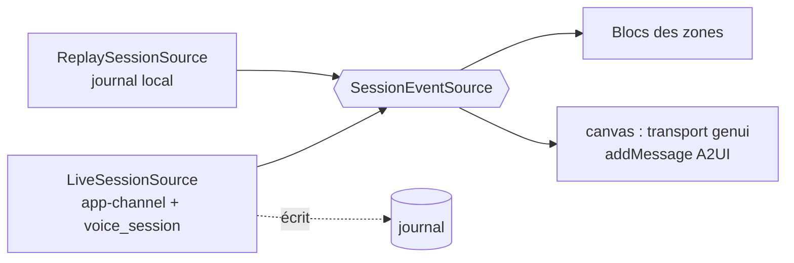

# Architecture de l'app Flutter desktop

**En bref.** L'app est un écran unique en 6 zones ([p-fn-screen](../functional/screen.md)), découpé en slices FSD dont chacune suit Clean en interne ([arch-clean-fsd-combo]). Toutes les zones lisent **un seul flux d'événements de session**, fourni soit par le backend (direct), soit par le journal (rejeu) : le rejeu de l'acte 4 réutilise donc exactement le même rendu ([p-ar-replay](replay.md)).

> Statut : **draft**. Tout ce qui suit est une **proposition** de l'assistant (noms de slices, Blocs, arborescence), à valider, sauf les parties marquées « réel » (fonctionnalité 005, 2026-10-30). Les règles non négociables viennent de AGENTS.md §2 et [adr-0001-initial-constraints].

## Règles appliquées

| Règle | Application ici | Source |
|---|---|---|
| Clean + FSD, imports vers le bas, barrel par slice | `export … show` dans un fichier de librairie par slice | [arch-fsd-public-api] |
| `get_it` + `injectable`, injection par constructeur | `getIt` appelé seulement dans `pages/genesis_canvas` (racine de composition) et `app/di` ; exception « racine de composition » de la règle d'AGENTS.md § 2 (Q-72 → pdr-0057) | [di-no-service-locator] |
| Bloc uniquement, events/states `sealed`/`freezed`, transformer explicite | Voir tableau des Blocs | [bloc-no-cubit], [bloc-event-transformers] |
| Une seule capture micro | `getUserMedia` de `flutter_webrtc` uniquement, jamais `record` en parallèle | [rt-echo-cancellation], [proj-avw-risks] n°3 |
| `stop` distinct de `dispose` | Port `VoiceSession` | [rt-provider-abstraction], [rt-graceful-close] |
| Config injectée | Modèle, voix, URL backend, `catalogId` lus depuis la config d'environnement | [proj-avw-risks] n°6 |
| État genui hors des Blocs | Les Blocs ne connaissent que des `surfaceId` et des phases | [genui-conversation-events], [ma-flutter-event-bus] |

## Slices FSD proposées

| Couche | Slice | Rôle | Exigences |
|---|---|---|---|
| app | `app/` | bootstrap, DI racine, thème de scène, table des raccourcis, config | NFR-05, NFR-12 |
| pages | `genesis_canvas` | page unique, racine de composition (`BlocProvider`) | — |
| widgets | `top_bar` | orbe, transcription (répliques du speaker et de l'IA, réplique coupée tronquée : [pdr-0025](../decisions/pdr-0025-top-bar-speaker-and-ai-lines.md)), forme d'onde | FR-02, FR-19, RG-17 |
| widgets | `canvas_board` | grille des surfaces (6 max) | FR-01, FR-04, FR-07, FR-15 |
| widgets | `agents_rail` | orchestrateur + agents, liaisons animées | FR-03 |
| widgets | `protocol_panel` | flux A2UI, repliable, mise en évidence | FR-05 |
| widgets | `catalog_shelf` | étagère des composants | FR-06 |
| widgets | `replay_bar` | lecture, pause, vitesse (acte 4) | FR-09 |
| features | `voice_session` | session voix (port + adaptateur GPT-Live WebRTC) | FR-02, FR-12, FR-13, FR-20 |
| features | `canvas` | rendu GenUI, catalogue `genesis`, cycle de vie des surfaces, actions | FR-04, FR-07, FR-08, FR-16 |
| features | `agent_activity` | état des agents à partir des événements d'orchestration | FR-03 |
| features | `protocol_feed` | journal lisible des messages A2UI | FR-05 |
| features | `replay` | journal du flux A2UI, lecteur (acte 4) | FR-09 |
| features | `stage_controls` | contrôles cliquables et raccourcis facultatifs → events Bloc | FR-11, FR-20, NFR-12 |
| entities | `session` | `SessionEvent` (sealed), port `SessionEventSource`, `TranscriptSegment` | — |
| entities | `catalog` | descripteur pur Dart du catalogue (noms, ids) partagé par `canvas` et `catalog_shelf` | FR-06 |
| shared | `core`, `backend_channel`, `realtime_transport`, `design_system` | Result, config, horloge ; client WSS app-channel maison (`genui_a2a` hors stack de l'app, [pdr-0045](../decisions/pdr-0045-app-backend-channel-wss-recommended.md)) ; WebRTC ; DS `Ds*` | — |

Les features ne s'importent pas entre elles : elles se coordonnent par les ports de `entities/session` ([arch-clean-fsd-combo]).

## Flux unique d'événements



`SessionEvent` (proposition) : `TranscriptDelta`, `OrbStateChanged`, `AgentActivity`, `A2uiMessageReceived(raw, parsed, seq, ts)`, `UserActionSent`, `SessionClosed`. Le rejeu de l'acte 4 remplace la source branchée sur le port ; les Blocs ne changent pas ([p-ar-replay](replay.md)). Plus de bascule secours ([pdr-0032](../decisions/pdr-0032-obs-video-fallback-a2ui-replay-act.md)).

## Blocs principaux (proposition)

| Bloc | Events clés | States clés | Transformer |
|---|---|---|---|
| `VoiceSessionBloc` | `VoiceSessionStarted`, `VoiceSessionStopped`, `MicMuteToggled`, `SilenceRequested`, `VoiceEventReceived` | `Idle`, `Connecting`, `Active(orb: repos/écoute/réflexion/parole/interrompue/microCoupé)`, `Failed` | `restartable` (start), `droppable` (toggle), `sequential` (events) |
| `TranscriptBloc` | `TranscriptDeltaReceived`, `AiReplyTruncated` | lignes `{rôle, texte, tronquée}` | `sequential` |
| `CanvasBloc` | `A2uiMessageReceived(A2uiMessage)`, `CanvasResetRequested` (commandes), `CanvasSourceSubscribed(Stream<A2uiMessage>)` | `surfaceIds` ordonnés + phase `squelette/composants/données` + statut de source `none/playing/completed/failed` | `sequential` (commandes), `restartable` (source, `emit.onEach`) |
| `AgentsRailBloc` | `AgentActivityReceived` | par agent : `veille/actif`, tâche, compteur | `sequential` |
| `ProtocolFeedBloc` | `A2uiMessageLogged`, `PanelToggled`, `MessageHighlighted` | entrées, déplié, id en évidence, total/taille | `sequential` / `droppable` |
| `CatalogShelfBloc` | `ComponentUsed`, `ComponentReleased` | usage par composant | `sequential` |
| `ReplayBloc` | `FallbackRequested`, `ReplayRequested`, `SpeedChanged`, `Seeked`, `Stepped` | `Live`, `Replaying(position, vitesse 0,25×–2×)` | `restartable` (seek) |

- Les flux sont consommés via `emit.forEach` ([bloc-emit-foreach]).
- L'**orbe** et la **forme d'onde** ne passent pas par un Bloc : niveau audio dans un `ValueListenable` lu par un `CustomPainter` sous `RepaintBoundary` ([perf-audio-visualizer-60hz], NFR-04).
- Les raccourcis (fiche §6, « à valider », écart E5) sont des `Shortcuts`/`Actions` dont les Actions reçoivent le Bloc par constructeur ([ux-desktop-shortcuts]).

## DI

- `get_it` 9.3 + `injectable` 3.0 ([di-setup-versions]) ; environnements proposés : `live` (backend réel), `replay` (journal seul, J6), `test` (fakes aux frontières, [test-mock-boundaries-only]). `app/di` est introduit par 005 ([pdr-0044](../decisions/pdr-0044-di-deferred-to-j2.md), Q-66 tranchée).
- **État réel après 005, écarts assumés** par rapport à la proposition « un module par package » ([di-micro-packages]) :
  - modules injectable écrits **dans `app/di`** : les paquets ne dépendent pas d'`injectable` ;
  - graphe `live` **seul**, résolu sans entrée-sortie, **sans fake dans `lib/`** : les tests ne remplacent que la fabrique de transport et pointent `GENESIS_BACKEND_URL` sur un faux backend local réel ;
  - **un `GetIt` par instance d'app** (`GetIt.asNewInstance()`), pas de variable globale ; **pas de scope par session en J2** (la portée get_it par session, proposée à l'origine pour `VoiceSession`, transport genui et bus d'événements, est reportée) ;
  - fabriques `VoiceTransport Function()` et `EnvelopeLog Function()` **enregistrées à la main** : injectable ne sait pas enregistrer un type fonction ;
  - `VoiceSession` résolue **une seule fois** par la page racine de composition, qui construit dessus `LiveSessionEventSource` et `VoiceSessionBloc` ; `getIt` n'est appelé nulle part ailleurs (exception de la racine de composition : pdr-0057) ; le relais HTTP est fermé par `getIt.reset()`.
- **Fermeture de la page** (ordre testé) : `VoiceSessionBloc.close()`, `VoiceSession.stop()` (borné), `VoiceSession.dispose()`, `LiveSessionEventSource.dispose()`, `CanvasBloc.close()`, `SurfaceController.dispose()`. Sortie de la fenêtre : `AppLifecycleListener(onExitRequested)` + `ExitGuard` (`shared/core`).
- **Délais par défaut** : `relayDeleteTimeout` 7 s, `channelCloseTimeout` 2 s, `sessionCloseTimeout` 10 s, `exitCloseTimeout` 12 s (invariants testés : 10 s > 7 s + 2 s ; 12 s > 10 s + 1 s). **Réglages posés par l'assistant** (la spec disait « ~8 s ») : à confirmer par le porteur, sans bloquer.
- ⚠️ Hypothèse non confirmée : démarrage de la session par un bouton « Démarrer » (geste explicite) plutôt qu'automatique ; le raccourci éventuel relève de [pdr-0033](../decisions/pdr-0033-optional-shortcuts-mouse-first.md) (facultatif).

## Rendu GenUI

- `SurfaceController(catalogs: [genesisCatalog])` : un catalogue métier fermé, sans `BasicCatalogItems` complet ([genui-a2ui-security], [pdr-0007](../decisions/pdr-0007-closed-catalog-stage-theme.md)).
- Transport maison `BackendA2uiTransport implements Transport` : il pousse les messages déjà parsés (`addMessage`) venus de l'app-channel ou du journal ; aucun LLM côté client ([genui-architecture], [genui-custom-llm-adapter]).
- Les actions (`controller.onSubmit` / `UiInteractionPart`) repartent en **événements typés** sur l'app-channel ([genui-user-actions]). Un `ActionDelegate` intercepte les actions locales.
- Un widget `Surface(surfaceContext: controller.contextFor(id), defaultBuilder: squelette DS)` par surface active ; `CanvasBloc` ne garde que les ids ([genui-multiple-surfaces]).
- Les **3 temps** de FR-04 : squelette (`defaultBuilder` avant définition), composants (`updateComponents`), données (`updateDataModel`). Chaque `CatalogItem` affiche un état squelette tant que ses chemins liés sont vides, et un **état neutre** sur données incomplètes (fiche §7, RG-10). Noms de messages A2UI v0.9 ([pdr-0018](../decisions/pdr-0018-a2ui-v09-genui-0-10-4.md)).
- La disposition des surfaces dans le canevas est tenue par l'app : grille fixe, N surfaces, 6 max (NFR-06). `Grid` n'est pas dans le catalogue et l'IA ne place rien ([pdr-0015](../decisions/pdr-0015-app-held-canvas-layout.md), E11 · Q-29 tranché).

## Catalogue `genesis` et design system

- Chaque `CatalogItem` **enveloppe un composant `Ds*`** et lit le thème via `itemContext.buildContext` : couleurs et tailles viennent du **thème de scène**, jamais de l'agent ([ux-genui-catalog-as-ds], fiche §7).
- Contenu du catalogue : 6 `CatalogItem` (Indicateur clé, Courbe de tendance, Sentiment des avis, Checklist go/no-go, Barre d'actions, Liste des crashs), [pdr-0014](../decisions/pdr-0014-six-component-catalog.md) ; voir [p-fn-catalog](../functional/catalog.md). Chacun demande widget, schéma, squelette, état neutre, story Widgetbook, goldens.
- DS : M3 via `material_ui` ([adr-0004-ds-visual-base-m3]) ; tokens DTCG → Style Dictionary ([adr-0005-ds-tokens-style-dictionary]) avec un thème « scène » (texte ≥ 24 px, contraste WCAG AA, NFR-05) ; maquettes dans Claude Design ([adr-0007-ds-design-tool-claude-design]).
- Widgetbook `4.0.0-beta.14` exact, sans Cloud ([adr-0008-ds-widgetbook-4-beta], [adr-0006-ds-no-widgetbook-cloud]) : une story par `CatalogItem`, et des scénarios `CachedSurface` alimentés par les **messages A2UI du journal de répétition** ([ds-widgetbook-4-genui]).

## Arborescence (proposée ; réel après 005 en commentaire)

```
apps/genesis_canvas/                 # app desktop (Linux, pdr-0028)
  lib/app/{di,bootstrap,theme,shortcuts,config}/   # réel : di, bootstrap, config, lifecycle, scenario
  lib/pages/genesis_canvas/
  lib/widgets/{top_bar,canvas_board,agents_rail,protocol_panel,catalog_shelf,replay_bar}/  # réel : top_bar, agents_rail
packages/features/{voice_session,canvas,agent_activity,protocol_feed,replay,stage_controls}/  # réel : voice_session, canvas, agent_activity
packages/entities/                   # session/, catalog/ (pur Dart) ; réel : session
packages/shared/{core,backend_channel,realtime_transport,design_system}/  # réel : core, backend_channel
packages/shared/design_system/widgetbook/
testing/                             # réel : backend_fakes, voice_fakes, bloc_harness
```

**Réel après 005** (les paquets s'importent vers le bas ; test d'architecture : `pages` et `widgets` n'importent pas `app/`) :

| Paquet | Contenu |
|---|---|
| `entities/session` | `SessionEvent` (sealed), port `SessionEventSource`, enum `AgentTaskState` |
| `shared/core` | `A2uiDecoder`, `AppClock`, `ExitGuard` |
| `shared/backend_channel` | `AppChannelEnvelope`, `WebSocketAppChannel`, `HttpVoiceRelay`, `EnvelopeLog` ([contrat](app-channel-contract.md)) |
| `features/voice_session` | `VoiceSession` (machine à états), `VoiceFailure` fermé, `FlutterWebRtcTransport` derrière la façade `WebRtcPlatform`, `LiveSessionEventSource`, `VoiceSessionBloc`, `TranscriptBloc`, `OrbSmoother`, `OrbLevelController` |
| `features/agent_activity` | `AgentActivityBloc` |
| `testing/*` | `backend_fakes` (faux backend HTTP + WebSocket réel), `voice_fakes` (faux transport, `VoiceHarness`), `bloc_harness` |

Adaptée de [arch-recommended-structure] et [ds-package-structure] ; workspace pub ([arch-pub-workspaces]).

## Contexte repris de `knowledge/` (transféré le 2026-10-28)

Passages propres au projet retirés des notes génériques (souvent antérieurs à la fiche produit) ; ils ne remplacent pas les propositions ci-dessus.

| Origine (knowledge) | Contenu |
|---|---|
| [arch-recommended-structure] | Arborescence d'origine : `ai_voice_ui/` (pubspec racine : workspace + melos) ; `apps/assistant_app/lib/` = `app/{di,router,theme,bootstrap}/` (`main_{dev,staging,prod}.dart` à côté), `pages/{assistant,settings,onboarding}/{ui,model}/`, `widgets/assistant_shell/` (shell voix + surface GenUI) ; `packages/features/` = `orchestrator/` (routage intentions/tool calls, sur les ports uniquement), `voice_agent/` (OpenAI gpt-live / Gemini Live ; `lib/{voice_agent.dart, src/{ui,model/{state,domain},api/{openai,gemini},config}}`), `genui_agent/` (genui + A2UI, catalogue) ; `packages/entities/` (pur Dart : `agent/`, `session/`, `user/`) ; `packages/shared/{core,realtime_transport,design_system}` ; `testing/` ; `tools/arch_lints/`. Clés éphémères récupérées par `voice_agent/api` via un service backend. L'app s'appelait `apps/assistant_app` dans [arch-recommended-dependency-rules] et [arch-pub-workspaces] |
| [arch-official-use-cases] | Use-cases explicites prévus pour l'orchestrateur : `RouteUserIntent`, `DelegateUiToGenUiAgent` ; l'orchestrateur combine session voix, surface GenUI et contexte métier |
| [arch-clean-fsd-combo] | `VoiceAi` (orchestrateur du domaine d'ai_voice_widget) devient la feature `orchestrator` de l'app |
| [arch-official-components] | Transposition : `OpenAiRealtimeService` / `GeminiLiveService` services sans état, `VoiceSessionRepository` porte état, events et tool calls, `VoiceSessionBloc` tient le rôle de ViewModel (la note citait `VoiceSessionCubit` par erreur) |
| [ma-flutter-event-bus] | Instanciation d'origine : `AgentEventBus` (domaine), `Stream<AgentEvent>` broadcast : `VoiceStateChanged(listening\|speaking\|thinking)`, `TranscriptDelta(role, text)`, `DelegationStarted/Progress/Completed(id…)`, `SurfaceAdded/Removed(surfaceId)`, `ErrorEvent` ; `VoiceSessionBloc` (session, micro), `ConversationBloc` (transcription) ; `DelegationId` en vol → « je regarde… » à l'écran ; état GenUI hors BLoC ([proj-avw-genui-bridge]). Correspondance avec `SessionEvent` ci-dessus : `OrbStateChanged`, `TranscriptDelta`, `AgentActivity`, `A2uiMessageReceived` |
| [rt-openai-webrtc-package], [rt-flutter-webrtc-gpt-live-connect] | Runner GPT-Live maison sur `flutter_webrtc` ; `openai_webrtc` sert de lecture, pas de dépendance. `backend.createLiveSession(local.sdp)` appelle le relais SDP du backend du produit |
| [adr-0004-ds-visual-base-m3] (contexte d'origine) | Cible « desktop et web » avec Flutter 3.47 ; le produit reste desktop seul ([pdr-0026](../decisions/pdr-0026-desktop-only-target.md)) ; démo pour un talk Flutter GenUI ; DS sans Material écarté car trop coûteux pour une démo. Réexamen : M3 Expressive officiel dans `material_ui`, à évaluer pour la démo ; retours du talk réclamant un rendu natif par OS |
| [ds-widgetbook-4-genui] | Usage dans la démo du talk : le catalogue GenUI **est** le DS ([ux-genui-catalog-as-ds]), une story par `CatalogItem` avec args alignés sur le `dataSchema` = démonstration visible du talk ([adr-0008-ds-widgetbook-4-beta]) ; fixtures A2UI réelles versionnées rejouées via `CachedSurface`, un scénario par payload, sans réseau ni LLM ([replay.md](replay.md)) |
| [ds-widgetbook-monorepo] | Un seul catalogue `apps/widgetbook`, membre du pub workspace racine, dépendant du package DS (puis des slices UI) : une seule app à builder (desktop + web), une config d'addons/thèmes, un point d'entrée pour la revue et `widgetbook coverage`. L'arborescence proposée ci-dessus le place sous `packages/shared/design_system/widgetbook/` : deux propositions à harmoniser à la relecture |
| [ux-desktop-platform-kits] | Un seul DS maison sur `material_ui`, découplé de Material ([ds-material-ui-decoupling]), catalogué dans Widgetbook et réutilisé par le catalogue GenUI |
| [ds-color-dark-contrast] | « L'app cible desktop et web » (contexte d'origine ; produit desktop seul, [pdr-0026](../decisions/pdr-0026-desktop-only-target.md)) : ne pas compter sur `highContrastOf` seul ; réglage in-app « Contraste : système / standard / moyen / élevé » porté par un Bloc de préférences |
| [ds-widgetbook-a11y-tooling] | « App desktop + web » (contexte d'origine ; produit desktop seul, [pdr-0026](../decisions/pdr-0026-desktop-only-target.md)) : tester les composants DS avec `iOSTapTargetGuideline` (44) au minimum, `androidTapTargetGuideline` pour les composants tactiles ; tests a11y dans la suite du package DS, pas dans le catalogue |
| [ux-desktop-focus] | Régions F6 : navigation, transcript voix, surface GenUI, saisie ; un `FocusTraversalGroup` par région (à confronter aux 6 zones de [p-fn-screen](../functional/screen.md)) |
| [perf-web-initial-load] | Candidats au différé : catalogue GenUI et écrans rarement ouverts ; runner voix prêt dès le premier geste (opinion ; non appliquée : produit desktop seul, [pdr-0026](../decisions/pdr-0026-desktop-only-target.md)) |

## Points ouverts (registre : [p-rm-open-questions](../roadmap/open-questions.md))

- **Source du niveau audio** de l'orbe et de la forme d'onde sans seconde capture micro (statistiques WebRTC ou copie sideband) : copie sideband **mesurée en SP-02** (RMS exploitable : 0 au silence, 0,05–0,17 en parole, blocs de 200 ms) ; `audioLevel` des statistiques WebRTC **non testé** (⚠️) ; retenu (Q-43 tranchée, [pdr-0051](../decisions/pdr-0051-orb-level-from-sideband-rms-recommended.md)) : le backend calcule le RMS de la copie sideband, le pousse à 5 Hz sur l'app-channel et l'orbe interpole à 60 i/s ; ⚠️ Hypothèse non confirmée : 5 Hz suffisent visuellement, à vérifier sur l'orbe réelle en J2 (réexamen prévu par la PDR).
- **Mise en page du canevas** : tranchée, grille tenue par l'app, N surfaces ([pdr-0015](../decisions/pdr-0015-app-held-canvas-layout.md), Q-29).
- **`catalogId`** définitif (la maquette affiche `genesis.release`, la convention recommande une URI versionnée, [genui-catalog-ids]) → Q-44 tranchée : `https://genesis-canvas.example/a2ui/catalogs/genesis/v1` (pdr-0055).
- **genui sous Linux** : build exige les en-têtes GStreamer ; rendu confirmé par SP-10 le 2026-10-29 ([genui-overview], [pdr-0028](../decisions/pdr-0028-linux-demo-machine.md)). Q-45 (Windows) sans objet.
- **Raccourcis** : tranché (Q-05, [pdr-0033](../decisions/pdr-0033-optional-shortcuts-mouse-first.md)) : facultatifs, toute action critique à la souris.
