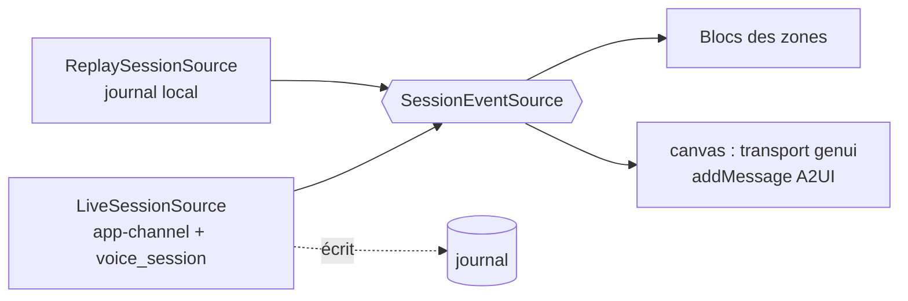

# Architecture de l'app Flutter desktop

**En bref.** L'app est un écran unique en 6 zones ([p-fn-screen](../functional/screen.md)), découpé en slices FSD dont chacune suit Clean en interne ([arch-clean-fsd-combo]). Toutes les zones lisent **un seul flux d'événements de session**, fourni soit par le backend (direct), soit par le journal (rejeu) : le rejeu de l'acte 4 réutilise donc exactement le même rendu ([p-ar-replay](replay.md)). Écran, catalogue `genesis` et remise à vide tels que livrés par 007 : [p-ar-frontend-screen](frontend-screen.md).

> Statut : **draft**. Tout ce qui suit est une **proposition** de l'assistant (noms de slices, Blocs, arborescence), à valider, sauf les parties marquées « réel » (fonctionnalités 005 et 007, 2026-10-30). Les règles non négociables viennent de AGENTS.md §2 et [adr-0001-initial-constraints].

## Règles appliquées

| Règle | Application ici | Source |
|---|---|---|
| Clean + FSD, imports vers le bas, barrel par slice | `export … show` dans un fichier de librairie par slice | [arch-fsd-public-api] |
| `get_it` + `injectable`, injection par constructeur | `getIt` appelé seulement dans `pages/genesis_canvas` (racine de composition) et `app/di` ; exception « racine de composition » de la règle d'AGENTS.md § 2 (Q-72 → pdr-0057) | [di-no-service-locator] |
| Bloc uniquement, events/states `sealed`/`freezed`, transformer explicite | Voir tableau des Blocs | [bloc-no-cubit], [bloc-event-transformers] |
| Une seule capture micro | `getUserMedia` de `flutter_webrtc` uniquement, jamais `record` en parallèle | [rt-echo-cancellation], [proj-avw-risks] n°3 |
| `stop` distinct de `dispose` | Port `VoiceSession` | [rt-provider-abstraction], [rt-graceful-close] |
| Config injectée | Modèle, voix, URL backend, `catalogId` lus depuis la config d'environnement | [proj-avw-risks] n°6 |
| État genui hors des Blocs | Les Blocs ne connaissent que des `surfaceId` et des phases | [genui-conversation-events], [ma-flutter-event-bus] |

## Slices FSD (proposées ; réalisées par 005 et 007 : voir « Arborescence »)

| Couche | Slice | Rôle | Exigences |
|---|---|---|---|
| app | `app/` | bootstrap, DI racine, thème de scène, table des raccourcis, config | NFR-05, NFR-12 |
| pages | `genesis_canvas` | page unique, racine de composition (`BlocProvider`) | — |
| widgets | `top_bar` | orbe, transcription (répliques du speaker et de l'IA, réplique coupée tronquée : [pdr-0025](../decisions/pdr-0025-top-bar-speaker-and-ai-lines.md)), forme d'onde | FR-02, FR-19, RG-17 |
| widgets | `agents_rail` | orchestrateur + agents, liaisons animées | FR-03 |
| widgets | `protocol_panel`, `catalog_shelf`, `replay_bar`, `stage_bar` | flux A2UI repliable (FR-05) ; étagère (FR-06) ; lecture, pause, vitesse de l'acte 4 (FR-09, active depuis 010) ; acte et remise à vide (FR-11) | FR-05, FR-06, FR-09, FR-11 |
| features | `voice_session` | session voix (port + adaptateur GPT-Live WebRTC) | FR-02, FR-12, FR-13, FR-20 |
| features | `canvas` | rendu GenUI, catalogue `genesis`, `A2uiGate`, `CanvasBoard` (grille, 6 max), cycle de vie des surfaces, actions | FR-01, FR-04, FR-07, FR-08, FR-15, FR-16 |
| features | `agent_activity` | état des agents à partir des événements d'orchestration | FR-03 |
| features | `protocol_feed` | journal lisible des messages A2UI | FR-05 |
| features | `replay` | routeur vivant / rejeu, lecteur, Bloc du rejeu (acte 4, livré par 010 ; le journal est dans `entities/session`) | FR-09 |
| features | `stage_controls` | contrôles cliquables et raccourcis facultatifs → events Bloc | FR-11, FR-20, NFR-12 |
| entities | `session` | `SessionEvent` (sealed), port `SessionEventSource`, `TranscriptSegment` | — |
| entities | `catalog` | pur Dart : `GenesisContract` (noms, ids, propriétés, champs requis) et `GenesisMessageValidator`, partagés par `canvas`, `protocol_feed` et `catalog_shelf` | FR-06 |
| shared | `core`, `backend_channel`, `realtime_transport`, `design_system` | Result, config, horloge ; client WSS app-channel maison (`genui_a2a` hors stack de l'app, [pdr-0045](../decisions/pdr-0045-app-backend-channel-wss-recommended.md)) ; WebRTC ; DS `Ds*` | — |

Les features ne s'importent pas entre elles : elles se coordonnent par les ports de `entities/session` ([arch-clean-fsd-combo]).

## Flux unique d'événements



`SessionEvent` (proposition) : `TranscriptDelta`, `OrbStateChanged`, `AgentActivity`, `A2uiMessageReceived(raw, parsed, seq, ts)`, `UserActionSent`, `SessionClosed`. Le rejeu de l'acte 4 remplace la source branchée sur le port ; les Blocs ne changent pas ([p-ar-replay](replay.md)). Plus de bascule secours ([pdr-0032](../decisions/pdr-0032-obs-video-fallback-a2ui-replay-act.md)).

## Blocs principaux (proposition ; réalisés après 005 et 007, voir la dernière colonne)

| Bloc | Events clés | States clés | Transformer |
|---|---|---|---|
| `VoiceSessionBloc` | `VoiceSessionStarted`, `VoiceSessionStopped`, `MicMuteToggled`, `SilenceRequested`, `VoiceEventReceived` | `Idle`, `Connecting`, `Active(orb: repos/écoute/réflexion/parole/interrompue/microCoupé)`, `Failed` | `restartable` (start), `droppable` (toggle), `sequential` (events) ; **011** : la phase de l'orbe vit dans `OrbPhaseBloc` (`Listening`, `Speaking`, `Interrupted`), hors de `VoiceSessionStatus` ; **réel après 014** : `VoiceSessionSubscribed`, `VoiceSessionStarted`, `VoiceSessionStopped`, **`VoiceMicMuteRequested(bool muted)`** (valeur cible, `sequential()`, remplace `MicMuteToggled`), états `Idle`, `Connecting`, **`Active({micMuted})`** (le micro coupé est un drapeau d'`Active`, pas une phase), `Stopping`, `Failed` ; « Faire taire » n'est pas un event du Bloc : `VoiceSession.silenceRemote()` (qui émet l'événement local `VoiceSilenced`), appelé par la page ; `canSilence(status, phase)` est la règle unique du bouton et d'`Échap` ([p-ar-frontend-screen](frontend-screen.md) § 014) |
| `TranscriptBloc` | `TranscriptDeltaReceived`, `AiReplyTruncated` | lignes `{rôle, texte, tronquée}` | `sequential` |
| `CanvasActionBloc` (réel 009) | `ActionRequested(name, surfaceId)`, `ActionActivityChanged(busy)`, fin de session, remise à zéro | `Idle`, `Sending`, `Running` (jusqu'à la fin d'activité des agents, la fermeture de session ou la durée maximale), `Failed` ; réessai borné sur `busy` / `noSession` | `droppable` (aucun second clic pendant une action) |
| `CanvasBloc` | `A2uiMessageReceived(A2uiMessage)`, `CanvasResetRequested` (commandes), `CanvasSourceSubscribed(Stream<A2uiMessage>)` | `surfaceIds` ordonnés + phase `squelette/composants/données` + statut de source `none/playing/completed/failed` | `sequential` (commandes), `restartable` (source, `emit.onEach`) |
| `AgentActivityBloc` (réel 007) | `AgentActivitySourceSubscribed`, `AgentActivityReset` | lignes du rail (orchestrateur, `selected`, `idle` du dernier `plan`) : `idle/pending/working/completed/failed/rejected/interrupted`, `noAgentSelected`, `anyBusy` | `restartable` (source), `sequential` (reset) |
| `ProtocolFeedBloc` (réel 007) | `ProtocolSourceSubscribed`, `PanelToggled`, `ProtocolFeedCleared` | entrées horodatées (`AppClock`) avec verdict, `expanded`, `highlightedIndex` / `highlightedSurfaceId` | `restartable` (source), `droppable` (`PanelToggled`), `sequential` |
| `CatalogShelfBloc` (réel 007) | `CatalogShelfSourceSubscribed`, `CatalogShelfCleared` | 6 composants du contrat, `used`, `usedCount` / `total` | `restartable` (source), `sequential` |
| `StageBloc` (réel 007) | `StageActAdvanced`, `StageActReached` (011, monotone), `StageResetRequested` | acte 1 à 3 (« Créer », « Transformer », « Interagir ») | `sequential` ; ne mute aucun autre Bloc : la page relaie la remise à vide et les signaux d'acte ([p-ar-frontend-screen](frontend-screen.md) § 011) |
| `ReplayBloc` | `FallbackRequested`, `ReplayRequested`, `SpeedChanged`, `Seeked`, `Stepped` | `Live`, `Replaying(position, vitesse 0,25×–2×)` | `restartable` (seek) |

- Les flux sont consommés via `emit.forEach` ([bloc-emit-foreach]). L'**orbe** et la **forme d'onde** ne passent pas par un Bloc : niveau audio dans un `ValueListenable` lu par un `CustomPainter` sous `RepaintBoundary` ([perf-audio-visualizer-60hz], NFR-04). Les raccourcis (fiche §6, « à valider », écart E5) sont des `Shortcuts`/`Actions` dont les Actions reçoivent le Bloc par constructeur ([ux-desktop-shortcuts]).

## DI

`get_it` 9.3 + `injectable` 3.0 ([di-setup-versions]) ; `app/di` introduit par 005 ([pdr-0044](../decisions/pdr-0044-di-deferred-to-j2.md), Q-66 tranchée). État réel et écarts assumés (modules dans `app/di`, graphe `live` seul sans fake dans `lib/`, un `GetIt` par instance d'app, fabriques enregistrées à la main, `getIt` confiné à la page racine de composition : [pdr-0057](../decisions/pdr-0057-getit-composition-root-exception.md)), ordre de fermeture et délais : [p-ar-frontend-screen](frontend-screen.md) § DI et fermeture. Environnements proposés : `live`, `replay` (J6), `test` ([test-mock-boundaries-only]).
⚠️ Hypothèse non confirmée : démarrage de la session par un bouton « Démarrer » (geste explicite) plutôt qu'automatique ([pdr-0033](../decisions/pdr-0033-optional-shortcuts-mouse-first.md) pour un raccourci éventuel).

## Rendu GenUI et catalogue `genesis`

Détail réel (BoundObject, trois états, squelette peint par `CanvasBoard`, `A2uiGate`, thème de scène) : [p-ar-frontend-screen](frontend-screen.md).

- `SurfaceController(catalogs: [genesisCatalog])` : catalogue métier fermé de 6 `CatalogItem` ayant un schéma (`ActionBar` depuis 009 ; `CrashList` depuis 012), sans `BasicCatalogItems` ([genui-a2ui-security], [pdr-0007](../decisions/pdr-0007-closed-catalog-stage-theme.md), [pdr-0053](../decisions/pdr-0053-client-side-a2ui-validation-from-007.md)) ; contenu : [p-fn-catalog](../functional/catalog.md), [pdr-0014](../decisions/pdr-0014-six-component-catalog.md).
- Transport maison `BackendA2uiTransport implements Transport` (proposition) : messages déjà parsés (`addMessage`) venus de l'app-channel ou du journal, aucun LLM côté client ([genui-architecture], [genui-custom-llm-adapter]). Les clics de la Barre d'actions repartent en **événements typés** ([genui-user-actions]) : la `Surface` (genui 0.10.4) propose le clic de l'`ActionBar` à un `ActionDelegate` avant tout envoi à un LLM ; il envoie `ActionRequested` au `CanvasActionBloc`, puis `POST /canvas/actions` ; rien n'est renvoyé à un LLM côté client ([p-ar-frontend-screen](frontend-screen.md) § Acte 3). Livré par 009.
- Un `Surface` par surface active ; `CanvasBloc` ne garde que les ids et les phases ([genui-multiple-surfaces]). Grille tenue par l'app, 6 max ([pdr-0015](../decisions/pdr-0015-app-held-canvas-layout.md), NFR-06). Noms A2UI v0.9 ([pdr-0018](../decisions/pdr-0018-a2ui-v09-genui-0-10-4.md)).
- Chaque `CatalogItem` lit le **thème de scène** (`SceneTheme`, `shared/design_system`), jamais un style de l'agent ([ux-genui-catalog-as-ds]). DS : M3 via `material_ui` ([adr-0004-ds-visual-base-m3]), tokens DTCG ([adr-0005-ds-tokens-style-dictionary]) générés en `SceneTokens` (013, avec écarts : Q-86). Widgetbook `4.0.0-beta.14` sans Cloud ([adr-0008-ds-widgetbook-4-beta], [adr-0006-ds-no-widgetbook-cloud], [ds-widgetbook-4-genui]) : **stories des 6 composants et des 3 briques livrées par 013** (`apps/genesis_widgetbook`), goldens par `CatalogItem` reportés ; détail : [p-ar-design-system](design-system.md).

## Arborescence (proposée ; réel après 007)

```
apps/genesis_canvas/                 # app desktop (Linux, pdr-0028)
  lib/app/{di,bootstrap,theme,shortcuts,config}/   # réel : di, bootstrap, config, lifecycle, scenario, theme
  lib/pages/genesis_canvas/                        # réel : page (racine de composition), capture, surveillance du moteur
  lib/widgets/{top_bar,agents_rail,protocol_panel,catalog_shelf,replay_bar,stage_bar}/  # réel : les six
packages/features/{voice_session,canvas,agent_activity,protocol_feed,catalog_shelf,stage_controls,replay}/  # réel : tous (replay depuis 010)
packages/entities/{session,catalog}/ # réel : les deux (catalog en Dart pur)
packages/shared/{core,backend_channel,design_system,realtime_transport}/  # réel : core, backend_channel, design_system
testing/                             # réel : backend_fakes, voice_fakes, bloc_harness, real_fonts (013)
```

Le dossier `widgets/canvas_board` de la proposition n'existe pas : `CanvasBoard` vit dans `features/canvas` (le canevas est la slice qui porte les surfaces). Le Widgetbook n'est pas sous `shared/design_system/` (règle d'import) : c'est `apps/genesis_widgetbook` (013, couche app, membre du workspace).

**Réel après 007** (les paquets s'importent vers le bas ; tests d'architecture : `pages` et `widgets` n'importent pas `app/` ; **dépendances du workspace** lues dans tous les `pubspec.yaml` : `entities/catalog` sans `flutter` ni `genui`, `shared/*` sans `entities` ni `feature_*`, aucune `feature_*` ne dépend d'une autre, `testing/*` en `dev_dependencies` seulement) :

| Paquet | Contenu |
|---|---|
| `entities/session` | `SessionEvent` (sealed, dont `PlanReceived`), port `SessionEventSource`, enum `AgentTaskState` (dont `rejected`) |
| `entities/catalog` | `GenesisContract`, `GenesisMessageValidator`, `ValidationVerdict`, `ValidatedEnvelope`, `ValidationCodes` |
| `shared/core` | `A2uiDecoder`, `AppClock`, `ExitGuard`, `A2uiReplaySource` (`ReplayedMessage` : ligne brute + message) |
| `shared/backend_channel` | `AppChannelEnvelope`, `WebSocketAppChannel`, `HttpVoiceRelay`, `EnvelopeLog`, `CanvasResetClient` + `HttpCanvasResetClient`, `CanvasActionClient` + `HttpCanvasActionClient` (009, transport POST JSON partagé) ([contrat](app-channel-contract.md)) |
| `shared/design_system` | `SceneTheme`, `SceneStatus`, `DsSkeleton`, `DsNeutralState`, `DsStatusChip` |
| `features/voice_session` | `VoiceSession` (machine à états), `VoiceFailure` fermé, `FlutterWebRtcTransport` derrière `WebRtcPlatform`, `LiveSessionEventSource`, `VoiceSessionBloc`, `TranscriptBloc`, `OrbSmoother`, `OrbLevelController` |
| `features/canvas` | `genesisCatalog` (5 items, dont `ActionBar`), `A2uiGate`, `CanvasBloc`, `CanvasActionBloc`, `CanvasBoard` (grille + bandeau), `DashedOutlinePainter` |
| `features/{agent_activity,protocol_feed,catalog_shelf,stage_controls}` | un Bloc chacun (voir tableau des Blocs) |
| `testing/*` | `backend_fakes` (faux backend HTTP + WebSocket réel, route `POST /canvas/reset`, fixtures du contrat, `tool/gen_replay.dart`), `voice_fakes`, `bloc_harness` |

Adaptée de [arch-recommended-structure] et [ds-package-structure] ; workspace pub ([arch-pub-workspaces]).

## Contexte repris de `knowledge/` (transféré le 2026-10-28)

Passages propres au projet retirés des notes génériques (souvent antérieurs à la fiche produit) ; ils ne remplacent pas les propositions ci-dessus.

| Origine (knowledge) | Contenu |
|---|---|
| [arch-recommended-structure] | Arborescence d'origine : `ai_voice_ui/` (pubspec racine : workspace + melos) ; `apps/assistant_app/lib/` = `app/{di,router,theme,bootstrap}/` (`main_{dev,staging,prod}.dart` à côté), `pages/{assistant,settings,onboarding}/{ui,model}/`, `widgets/assistant_shell/` (shell voix + surface GenUI) ; `packages/features/` = `orchestrator/` (routage intentions/tool calls, sur les ports uniquement), `voice_agent/` (OpenAI gpt-live / Gemini Live ; `lib/{voice_agent.dart, src/{ui,model/{state,domain},api/{openai,gemini},config}}`), `genui_agent/` (genui + A2UI, catalogue) ; `packages/entities/` (pur Dart : `agent/`, `session/`, `user/`) ; `packages/shared/{core,realtime_transport,design_system}` ; `testing/` ; `tools/arch_lints/`. Clés éphémères récupérées par `voice_agent/api` via un service backend. L'app s'appelait `apps/assistant_app` dans [arch-recommended-dependency-rules] et [arch-pub-workspaces] |
| [arch-official-use-cases] | Use-cases explicites prévus pour l'orchestrateur : `RouteUserIntent`, `DelegateUiToGenUiAgent` ; l'orchestrateur combine session voix, surface GenUI et contexte métier |
| [arch-clean-fsd-combo] | `VoiceAi` (orchestrateur du domaine d'ai_voice_widget) devient la feature `orchestrator` de l'app |
| [arch-official-components] | Transposition : `OpenAiRealtimeService` / `GeminiLiveService` services sans état, `VoiceSessionRepository` porte état, events et tool calls, `VoiceSessionBloc` tient le rôle de ViewModel (la note citait `VoiceSessionCubit` par erreur) |
| [ma-flutter-event-bus] | Instanciation d'origine : `AgentEventBus` (domaine), `Stream<AgentEvent>` broadcast : `VoiceStateChanged(listening\|speaking\|thinking)`, `TranscriptDelta(role, text)`, `DelegationStarted/Progress/Completed(id…)`, `SurfaceAdded/Removed(surfaceId)`, `ErrorEvent` ; `VoiceSessionBloc` (session, micro), `ConversationBloc` (transcription) ; `DelegationId` en vol → « je regarde… » à l'écran ; état GenUI hors BLoC ([proj-avw-genui-bridge]). Correspondance avec `SessionEvent` ci-dessus : `OrbStateChanged`, `TranscriptDelta`, `AgentActivity`, `A2uiMessageReceived` |
| [rt-openai-webrtc-package], [rt-flutter-webrtc-gpt-live-connect] | Runner GPT-Live maison sur `flutter_webrtc` ; `openai_webrtc` sert de lecture, pas de dépendance. `backend.createLiveSession(local.sdp)` appelle le relais SDP du backend du produit |
| [adr-0004-ds-visual-base-m3] (contexte d'origine) | Cible « desktop et web » avec Flutter 3.47 ; le produit reste desktop seul ([pdr-0026](../decisions/pdr-0026-desktop-only-target.md)) ; démo pour un talk Flutter GenUI ; DS sans Material écarté car trop coûteux pour une démo. Réexamen : M3 Expressive officiel dans `material_ui`, à évaluer pour la démo ; retours du talk réclamant un rendu natif par OS |
| [ds-widgetbook-4-genui] | Usage dans la démo du talk : le catalogue GenUI **est** le DS ([ux-genui-catalog-as-ds]), une story par `CatalogItem` avec args alignés sur le `dataSchema` = démonstration visible du talk ([adr-0008-ds-widgetbook-4-beta]) ; fixtures A2UI réelles versionnées rejouées via `CachedSurface`, un scénario par payload, sans réseau ni LLM ([replay.md](replay.md)) |
| [ds-widgetbook-monorepo] | Un seul catalogue `apps/widgetbook`, membre du pub workspace racine, dépendant du package DS (puis des slices UI) : une seule app à builder (desktop + web), une config d'addons/thèmes, un point d'entrée pour la revue et `widgetbook coverage`. L'arborescence proposée ci-dessus le place sous `packages/shared/design_system/widgetbook/` : deux propositions à harmoniser à la relecture |
| [ux-desktop-platform-kits] | Un seul DS maison sur `material_ui`, découplé de Material ([ds-material-ui-decoupling]), catalogué dans Widgetbook et réutilisé par le catalogue GenUI |
| [ds-color-dark-contrast] | « L'app cible desktop et web » (contexte d'origine ; produit desktop seul, [pdr-0026](../decisions/pdr-0026-desktop-only-target.md)) : ne pas compter sur `highContrastOf` seul ; réglage in-app « Contraste : système / standard / moyen / élevé » porté par un Bloc de préférences |
| [ds-widgetbook-a11y-tooling] | « App desktop + web » (contexte d'origine ; produit desktop seul, [pdr-0026](../decisions/pdr-0026-desktop-only-target.md)) : tester les composants DS avec `iOSTapTargetGuideline` (44) au minimum, `androidTapTargetGuideline` pour les composants tactiles ; tests a11y dans la suite du package DS, pas dans le catalogue |
| [ux-desktop-focus] | Régions F6 : navigation, transcript voix, surface GenUI, saisie ; un `FocusTraversalGroup` par région (à confronter aux 6 zones de [p-fn-screen](../functional/screen.md)) |
| [perf-web-initial-load] | Candidats au différé : catalogue GenUI et écrans rarement ouverts ; runner voix prêt dès le premier geste (opinion ; non appliquée : produit desktop seul, [pdr-0026](../decisions/pdr-0026-desktop-only-target.md)) |

## Points ouverts (registre : [p-rm-open-questions](../roadmap/open-questions.md))

- **Source du niveau audio** de l'orbe et de la forme d'onde sans seconde capture micro (statistiques WebRTC ou copie sideband) : copie sideband **mesurée en SP-02** (RMS exploitable : 0 au silence, 0,05–0,17 en parole, blocs de 200 ms) ; `audioLevel` des statistiques WebRTC **non testé** (⚠️) ; retenu (Q-43 tranchée, [pdr-0051](../decisions/pdr-0051-orb-level-from-sideband-rms-recommended.md)) : le backend calcule le RMS de la copie sideband, le pousse à 5 Hz sur l'app-channel et l'orbe interpole à 60 i/s ; ⚠️ Hypothèse non confirmée : 5 Hz suffisent visuellement, à vérifier sur l'orbe réelle en J2 (réexamen prévu par la PDR).
- **`catalogId`** définitif (la maquette affiche `genesis.release`, la convention recommande une URI versionnée, [genui-catalog-ids]) → Q-44 tranchée : `https://genesis-canvas.example/a2ui/catalogs/genesis/v1` (pdr-0055).
- **genui sous Linux** : build exige les en-têtes GStreamer ; rendu confirmé par SP-10 le 2026-10-29 ([genui-overview], [pdr-0028](../decisions/pdr-0028-linux-demo-machine.md)). Q-45 (Windows) sans objet.
- **Raccourcis** : tranché (Q-05, [pdr-0033](../decisions/pdr-0033-optional-shortcuts-mouse-first.md)) : facultatifs, toute action critique à la souris. **Grille du canevas** : tranchée (Q-29, [pdr-0015](../decisions/pdr-0015-app-held-canvas-layout.md)).
