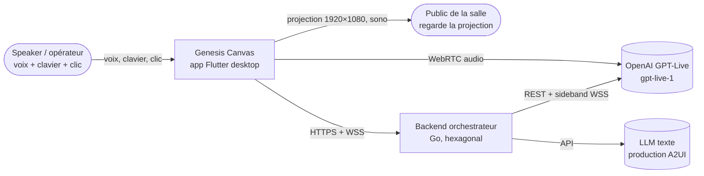
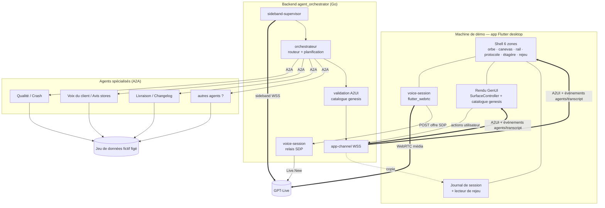

# Vue d'ensemble de l'architecture

**En bref.** Genesis Canvas est une app Flutter desktop Linux ([pdr-0028](../decisions/pdr-0028-linux-demo-machine.md), remplace pdr-0002) qui ne porte que l'audio WebRTC, le rendu A2UI et la régie de scène. Toute l'intelligence (session voix, orchestrateur, agents A2A, production A2UI) vit dans un backend Go hexagonal ([adr-0002-orchestrator-backend], [adr-0003-backend-go]). Tout tourne en local : backend et agents par `docker compose`, app en debug ([pdr-0029](../decisions/pdr-0029-local-docker-compose-hosting.md)). Un journal du flux A2UI rend chaque démo rejouable hors réseau : c'est l'acte 4 ([p-ar-replay](replay.md), [pdr-0032](../decisions/pdr-0032-obs-video-fallback-a2ui-replay-act.md)).

> Statut : **draft**. Synthèse de l'assistant à relire par le porteur. Les choix non tranchés sont listés en fin de page et renvoient à [p-rm-open-questions](../roadmap/open-questions.md).

## Principes

| # | Principe | Source |
|---|---|---|
| P1 | L'agent vocal est l'unique interlocuteur ; tout travail passe par **une seule délégation** vers l'orchestrateur | [ma-target-architecture] |
| P2 | Orchestrateur, agents et LLM côté **backend** ; le client ne garde que audio/WebRTC, rendu A2UI, outils locaux sans secret | [ma-where-to-run-agents], [adr-0002-orchestrator-backend], AGENTS.md §2 |
| P3 | L'agent produit de la **donnée d'interface** (A2UI), le client la rend avec **son** catalogue fermé | fiche §1 et §7 ; [genui-a2ui-security] ; [pdr-0007](../decisions/pdr-0007-closed-catalog-stage-theme.md) |
| P4 | L'écran montre la **fabrication** (agents, protocole, catalogue) en plus du résultat | fiche §6 ; [pdr-0008](../decisions/pdr-0008-single-screen-show-the-making.md) |
| P5 | Le flux A2UI de chaque session est **journalisé** et rejouable (acte 4) ; le secours est une vidéo gérée par le porteur | fiche §3, FR-09 ; [pdr-0032](../decisions/pdr-0032-obs-video-fallback-a2ui-replay-act.md) (remplace pdr-0006) |
| P6 | Données fictives **figées** ; seule la composition de l'UI varie | NFR-08 ; [pdr-0005](../decisions/pdr-0005-frozen-fictional-dataset.md) |
| P7 | Versions expérimentales **épinglées** exactement | NFR-10 ; [pdr-0010](../decisions/pdr-0010-pinned-experimental-versions.md) |
| P8 | Aucune clé longue durée dans l'app | NFR-09 ; [rt-ephemeral-keys] |

## Contexte (C4 niveau 1)

Le fournisseur voix OpenAI `gpt-live-1` est **accepté** ([pdr-0012](../decisions/pdr-0012-voice-provider-openai.md)). Le LLM texte qui compose l'A2UI n'est pas choisi (voir Points ouverts).

## Conteneurs (C4 niveau 2)

Agents : noms métier de la fiche, nombre libre, sélection visible par l'orchestrateur ([pdr-0013](../decisions/pdr-0013-orchestrator-visible-agent-selection.md), écart E1 tranché). Ce sont de vrais serveurs A2A, un processus chacun (un conteneur chacun : choix de conception), qui produisent l'A2UI de leurs surfaces ; l'orchestrateur valide et relaie ([pdr-0036](../decisions/pdr-0036-real-a2a-agents-produce-a2ui.md)).

## Déploiement local ([pdr-0029](../decisions/pdr-0029-local-docker-compose-hosting.md))

| Où | Quoi |
|---|---|
| `docker compose` (dépôt : Q-27, reco « ce dépôt ») | orchestrateur Go ; un conteneur par agent A2A (choix de conception) ; ports publiés sur `127.0.0.1` (Q-48, reco à confirmer) ; clé OpenAI en `.env` non commité |
| Machine Linux, hors conteneur | app Flutter desktop lancée en debug ([pdr-0028](../decisions/pdr-0028-linux-demo-machine.md)) |
| Réseau | seuls GPT-Live et le LLM texte sortent de la machine |

## Répartition client / backend

| Responsabilité | Où | Justification |
|---|---|---|
| Capture micro (source unique), lecture audio, WebRTC | Client | Latence ; AGENTS.md §2 ; [rt-echo-cancellation] |
| Création de session voix, clé OpenAI | Backend | [rt-gpt-live-webrtc-session], NFR-09 |
| Délégation, contexte, commentary | Backend (sideband) | [rt-gpt-live-sideband], [rt-gpt-live-delegation] |
| Orchestration, appels A2A, production A2UI (agents) et validation (orchestrateur) | Backend | [ma-where-to-run-agents], [genui-a2ui-security], [pdr-0036](../decisions/pdr-0036-real-a2a-agents-produce-a2ui.md) |
| Rendu A2UI, catalogue, thème de scène | Client | [genui-architecture], [ux-genui-catalog-as-ds] |
| Panneau protocole, rail des agents, étagère | Client (alimentés par l'app-channel) | fiche §6 |
| Journal A2UI et rejeu (acte 4) | Client (lecture locale, sans réseau) | FR-09 ; [p-ar-replay](replay.md) ; [pdr-0032](../decisions/pdr-0032-obs-video-fallback-a2ui-replay-act.md) |
| Raccourcis de régie | Client | NFR-12 ; [ux-desktop-shortcuts] |

## Carte exigences clés → composants

| Exigence | Composants qui la portent | Mécanisme | Page |
|---|---|---|---|
| NFR-01 voix < 1 s | WebRTC client ↔ GPT-Live ; sideband ; `acknowledgement_delay_ms` ; commentary | La voix répond pendant que les agents travaillent ([ma-filler-acknowledgements], [rt-latency]) | [backend](backend.md) |
| NFR-02 squelette < 1,5 s | Orchestrateur (squelette émis dès la planification) ; `createSurface` + composants squelette ; Bloc canevas | UI optimiste ([rt-latency] §5, [ux-genui-streaming-loading]) | [agents-protocols](agents-protocols.md) |
| NFR-03 acte 1 < 8 s | Orchestrateur (appels A2A parallèles) ; agents ; validation A2UI ; app-channel | Parallélisme, routage déterministe ([ma-target-architecture] pièges) | [backend](backend.md) |
| ~~NFR-07 secours < 2 s~~ | retirée ([pdr-0032](../decisions/pdr-0032-obs-video-fallback-a2ui-replay-act.md)) ; FR-09 : journal client et lecteur de rejeu, sans réseau | — | [replay](replay.md) |
| NFR-08 déterminisme | Jeu de données figé derrière les agents ; snapshots des réponses d'agents | Les agents lisent des fixtures, jamais de vraies sources | [replay](replay.md), [quality](quality.md) |
| NFR-09 aucune clé | Relais SDP backend ; clé en `.env` côté backend ; services sur `127.0.0.1` (Q-48, reco à confirmer) | [rt-ephemeral-keys], [pdr-0029](../decisions/pdr-0029-local-docker-compose-hosting.md) | [security](security.md) |

Tension NFR-01 / NFR-02 (fiche §5, « point délicat ») : la voix comble l'attente par des commentaires génériques, jamais par une hypothèse de résultat ([ma-filler-acknowledgements], [ma-real-tool-results]).

## Contexte repris de `knowledge/` (transféré le 2026-10-28)

| Origine (knowledge) | Contenu |
|---|---|
| [adr-0001-initial-constraints] (contexte d'origine, 2026-10-26) | Contraintes initiales du porteur : client Flutter avec exigences de performance **web, mobile et desktop** (le produit reste desktop seul : [pdr-0026](../decisions/pdr-0026-desktop-only-target.md), E22 · Q-64 ; OS : Linux, [pdr-0028](../decisions/pdr-0028-linux-demo-machine.md)) ; cible fonctionnelle = voix temps réel voice-to-voice (GPT-Live ou Gemini Live), UI générée (`genui` / A2UI), plusieurs agents (orchestrateur, voix, GenUI) communiquant via A2A, A2UI et MCP ; projets de référence `~/septeo/ai_voice_widget` et `~/septeo/septeo_saaster_kit` |
| [ma-target-architecture], [ma-where-to-run-agents] | Décision interne du projet, validée le 2026-10-27 : **orchestrateur backend dès la phase 1** (titres d'origine des deux notes ; désormais [adr-0002-orchestrator-backend]). L'architecture de l'app applique le patron de [ma-target-architecture] et le placement de [ma-where-to-run-agents] |
| [ma-target-architecture] | Pour le produit, reprise du pattern `show_screen` de [proj-avw-genui-bridge] en corrigeant les anti-patterns de [proj-avw-risks] : clé longue durée côté client, faux `{"status":"ok"}` |
| [ma-target-architecture] | Variante GPT-Live du produit : délégation `client` pour garder l'orchestrateur maison, ou délégation `responses` avec ses outils `function`/MCP si le workflow géré suffit (mode retenu ouvert : Q-47) |

## Pages de la zone

[frontend](frontend.md) · [backend](backend.md) · [agents-protocols](agents-protocols.md) · [stack](stack.md) · [replay](replay.md) · [security](security.md) · [quality](quality.md) · [stage-runtime](stage-runtime.md)

## Points ouverts (registre : [p-rm-open-questions](../roadmap/open-questions.md))

- ~~Où tourne le backend~~ : tranché, en local ([pdr-0029](../decisions/pdr-0029-local-docker-compose-hosting.md), Q-15).
- ~~Topologie A2UI~~ : tranchée, chaque agent produit son A2UI ([pdr-0036](../decisions/pdr-0036-real-a2a-agents-produce-a2ui.md), Q-37).
- **LLM texte** qui compose l'A2UI (modèle, fournisseur) : non choisi → Q-17.
- ~~Fournisseur voix~~ : `gpt-live-1` accepté ([pdr-0012](../decisions/pdr-0012-voice-provider-openai.md), Q-11).
