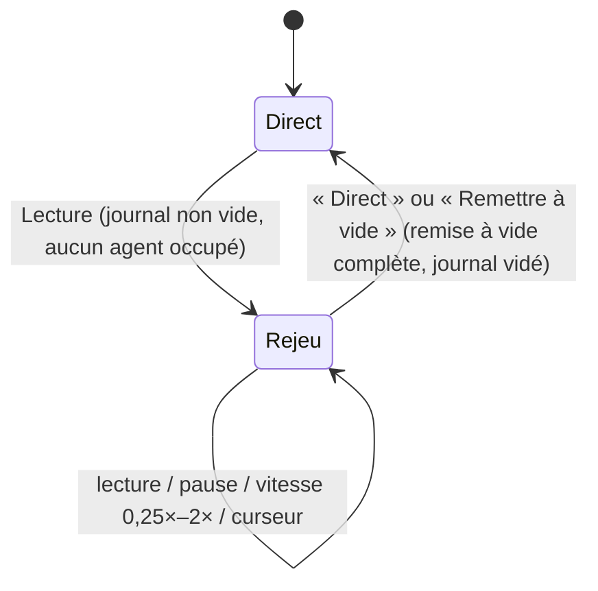

# Journal A2UI et rejeu (acte 4)

**En bref.** Chaque session écrit un **journal horodaté du flux A2UI** : les messages v0.9 tels que reçus par l'app, et rien d'autre n'est rejoué (Q-18 : « Flux A2UI seul »). Ni voix, ni transcription, ni actions utilisateur. Aucun marqueur n'est enregistré en J6 (les marqueurs de mesure relèvent de J8, voir plus bas). Le lecteur réinjecte ce journal dans le **même `A2uiGate`** que le direct (pdr-0066 D2) : le canevas se reconstruit à l'identique, de 0,25× à 2×, sans réseau ni LLM. C'est l'**acte 4** de la démo (FR-09, Must). Il n'y a **plus de mode secours intégré** : le secours est une vidéo OBS gérée par le porteur ([pdr-0032](../decisions/pdr-0032-obs-video-fallback-a2ui-replay-act.md), qui remplace [pdr-0006](../decisions/pdr-0006-replay-fallback-must.md)).

> Statut : **validé**. Journal et lecteur **livrés par la fonctionnalité 010** (J6, terminée le 2026-10-30) ; périmètre décidé par le porteur (pdr-0032), détails d'implémentation tranchés par la boucle sous pdr-0062 ([pdr-0066](../decisions/pdr-0066-010-act4-replay-details-assistant-decided.md) D1 à D8, contestables). Écran et budget des zones : [p-ar-frontend-screen](frontend-screen.md) § Acte 4.

## Exigences portées

| Exigence | Contrainte | Mécanisme |
|---|---|---|
| FR-09 | génération enregistrée, rejouable de 0,25× à 2× | journal en mémoire du flux A2UI brut + lecteur à pas fixe à vitesse variable ; **livrée par 010** (acceptation R-01 à R-09) |
| Acte 4 | l'acte 1 repasse au ralenti, synchronisé avec le JSON (fiche § 2) | le panneau protocole lit les mêmes entrées que le canevas |
| NFR-02, NFR-03 | mesure par « horodatage du journal A2UI » | horodatages monotones de l'app ([pdr-0038](../decisions/pdr-0038-latency-measured-on-app-clock.md)) |
| NFR-08 | données figées, seule la composition varie | jeu figé derrière les agents + snapshot de leurs réponses |
| ~~FR-10, NFR-07~~ | retirées par pdr-0032 | — |

## Format du journal (pdr-0066 D1)

Journal **en mémoire** côté client (`A2uiJournal`, `entity_session`), jamais écrit sur disque, sur `errorSink` ni dans les logs (JSON produit par un LLM). Plafond injecté (`replayJournalMaxEntries`, 5000 par défaut) : une fois plein, le journal cesse d'enregistrer (jamais d'éviction du début) et la page écrit une seule ligne sur `errorSink` (nombre de messages, jamais le contenu). Une entrée par message A2UI reçu du flux vivant, refus et ignorés compris (le validateur rejoué redonne les mêmes verdicts) :

| Champ | Contenu |
|---|---|
| `seq` | numéro d'ordre strict (l'ordre A2UI est obligatoire, [genui-a2ui-messages]) |
| `t_ms` | temps depuis le premier message, horloge de l'app, croissant ([pdr-0038](../decisions/pdr-0038-latency-measured-on-app-clock.md)) |
| `raw` | message A2UI **brut** tel que reçu (copie profonde non modifiable ; le message décodé n'est **jamais** conservé : il est redécodé depuis `raw` à chaque injection, car le moteur genui modifie en place les valeurs d'un `updateDataModel`) |
| `agent`, `task` | agent émetteur et tâche (lien protocole ↔ composant, FR-05) |

Aucun marqueur en J6 : les marqueurs de mesure (fin de phrase du speaker, début d'acte) servent NFR-02/03 et relèvent de J8. Les actions utilisateur ne sont pas enregistrées : leurs effets arrivent déjà sous forme de messages A2UI des agents. Le format de fichier JSONL `{t_ms, message}` n'est lu que par le rejeu scripté de la boucle (`GENESIS_SCENARIO`).

## Où enregistrer

| Journal | Rôle | Proposition |
|---|---|---|
| Client | source du rejeu de l'acte 4 et de la mesure | **canonique** |
| Backend (`session-recorder`) | diagnostic, snapshots des réponses d'agents | complémentaire |

Le journal vit le temps de la session : pas de persistance au-delà (fiche § 3). Les fichiers des répétitions servent à la mesure ([p-ar-quality](quality.md)).

## Lecteur de rejeu

- **Un seul chemin** ([pdr-0066](../decisions/pdr-0066-010-act4-replay-details-assistant-decided.md) D2) : un `ReplayRouter` se place devant l'`A2uiGate`. En direct il enregistre puis transmet ; en rejeu il jette (et compte) les messages vivants et le lecteur injecte les messages bruts du journal dans le **même** gate, validateur remis à zéro. Canevas, panneau du protocole et étagère se reconstruisent d'un seul flux.
- **Horloge à pas fixe** : un seul `Timer.periodic` (100 ms) ; la position avance de `pas × vitesse` et les entrées ≤ position sont émises ; l'attente entre deux messages est plafonnée (`replayMaxGap`, 3 s, D6).
- **Curseur** : remise à vide du canevas, du panneau (sans le replier) et de l'étagère, barrière d'un tour de boucle, puis réinjection instantanée jusqu'à la position ; le **même** `SurfaceController` est conservé (la remise à vide supprime les surfaces, comme en 007).
- **Pilotage** : à la souris (Lecture/Pause, Recommencer, curseur, cinq vitesses, Direct) ; pas de pas-à-pas ←/→ ([pdr-0059](../decisions/pdr-0059-acts-2-3-and-replay-simplifications.md)), aucun raccourci ([pdr-0033](../decisions/pdr-0033-optional-shortcuts-mouse-first.md)).
- Le rejeu ne touche pas à la session voix : il n'y a rien à dire pendant le rejeu, le speaker commente.
- **Entrée et sortie** (D3, D8) : « Lecture » entre en rejeu **sans appel backend** ; elle est inactive sans `createSurface` au journal (les échos d'une remise à vide ne comptent pas), pendant qu'un agent travaille ou qu'une action est en cours. « Direct » reste toujours actif : il sort par la remise à vide complète (`_resetStage`, journal vidé), comme « Remettre à vide » pendant un rejeu. Pendant le rejeu, les messages vivants sont écartés et **comptés** : une ligne « Rejeu : n messages vivants écartés » à la sortie. « Démarrer » et les boutons du canevas sont inactifs ; l'indicateur d'acte affiche « Acte 4 · Rejeu ».
- **Panneau du protocole** (EP-05) : il suit le message rejoué ; un positionnement du curseur vide ses entrées sans le replier (`ProtocolFeedEntriesCleared`). Seul le flux A2UI est rejoué (pdr-0032) : le rail des agents est donc vide pendant le rejeu.

## Réalisation (010)

| Élément | Où | Rôle |
|---|---|---|
| `A2uiJournal`, `JournalEntry` | `packages/entities/session` | journal en mémoire (`seq`, `t_ms`, `raw`, `agent`, `task`) |
| `ReplayRouter`, `ReplayPlayer`, `ReplayBloc`, `ReplaySettings`, port `ReplayStage` | `packages/features/replay` (nouvelle slice) | routage vivant / rejeu devant l'`A2uiGate`, lecteur à pas fixe, état dérivé du lecteur |
| `ReplayBar` | `apps/genesis_canvas/lib/widgets/replay_bar` | zone Rejeu de 480 px, deux rangées de 48 px (étagère ramenée à 900 px à 1920×1080) |

Le lecteur et le routeur n'ouvrent aucun accès réseau ; la fermeture de la page détruit le lecteur de façon synchrone (aucun minuteur actif après démontage).

### Variables d'environnement (`GenesisConfig`)

Une valeur invalide donne une erreur de configuration en français, sans recopier la valeur.

| Variable | Rôle | Défaut ; bornes |
|---|---|---|
| `GENESIS_REPLAY_MAX_GAP_MS` | écart maximal entre deux messages rejoués | 3000 ; 100 à 60000 |
| `GENESIS_REPLAY_TICK_MS` | pas de l'horloge du lecteur | 100 ; 10 à 1000 |
| `GENESIS_REPLAY_JOURNAL_MAX` | plafond du journal | 5000 ; 1 à 100000 |
| `GENESIS_REPLAY_SPEED` | vitesse au premier démarrage | 1 ; l'une de 0,25 / 0,5 / 1 / 1,5 / 2 |
| `GENESIS_REPLAY_AT` | mode capture : fraction de la durée comprimée | absent ; 0 à 1 |

**Mode capture** (`GENESIS_REPLAY_AT`, avec `GENESIS_SCENARIO` et `GENESIS_SNAPSHOT`) : à la fin du scénario scripté, la page entre en rejeu, se positionne à la fraction demandée, met en pause puis capture (`GENESIS_REPLAY_AT=0.5 app-smoke.sh act3-replay`). Sans la variable, le comportement de 000 est inchangé.

## Déterminisme

- Les agents ne lisent que le jeu de données figé ([pdr-0005](../decisions/pdr-0005-frozen-fictional-dataset.md), [p-fn-dataset](../functional/dataset.md)).
- Les réponses d'agents sont **snapshotées** par acte (mesure de NFR-08) et comparées en CI.
- Le rejeu est déterministe par construction : il n'appelle ni LLM ni réseau. **Vérifié par 010** : R-01 (mêmes surfaces, textes, phases et entrées du panneau que le direct, hors horodatage affiché) avec un faux backend qui ne reçoit aucune requête pendant le rejeu ; R-02 (durée ∝ 1/vitesse) ; R-03 (curseur avant et arrière).

## Réutilisations du journal

| Usage | Comment | Source |
|---|---|---|
| Tests BDD et widget | fake de transport qui rejoue un journal (frontière réseau) | [test-mock-boundaries-only] |
| Widgetbook | scénarios `CachedSurface` par payload A2UI enregistré, en fixtures JSON versionnées, sans réseau ni LLM ([frontend.md](frontend.md)) | [ds-widgetbook-4-genui] |
| Mesure des NFR | script qui calcule p90 sur 10 répétitions | [p-ar-quality](quality.md), [ma-voice-agent-evals] |

## Données personnelles et secrets

Le journal ne contient ni audio ni transcription (pdr-0032). Pas de secret dans les payloads A2UI ([p-ar-security](security.md)).

## Hors périmètre de l'app

- **Secours** : vidéo OBS enregistrée et lancée par le porteur ; décision direct / vidéo prise par lui sur place. Géré par le porteur, hors périmètre de l'assistant ([pdr-0032](../decisions/pdr-0032-obs-video-fallback-a2ui-replay-act.md)).
- Session de référence, bascule automatique, retour au direct : sans objet (Q-36, Q-50, Q-51).
