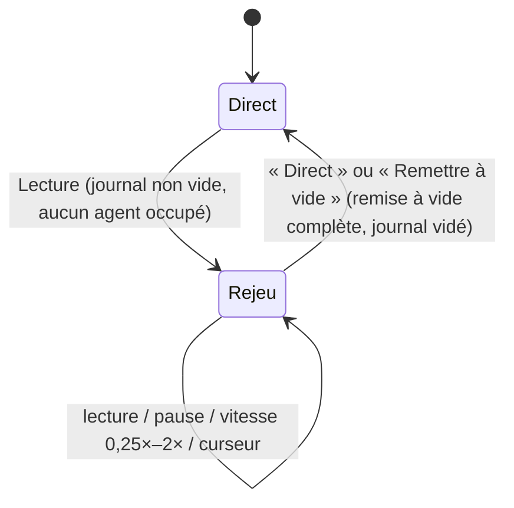

# Journal A2UI et rejeu (acte 4)

**En bref.** Chaque session écrit un **journal horodaté du flux A2UI** : les messages v0.9 tels que reçus par l'app, et rien d'autre n'est rejoué (Q-18 : « Flux A2UI seul »). Ni voix, ni transcription, ni actions utilisateur. Seuls des marqueurs de mesure, non rejoués, s'y ajoutent (proposition de l'assistant, voir plus bas). Le lecteur réinjecte ce journal dans le **même port** `SessionEventSource` que le direct : le canevas se reconstruit à l'identique, de 0,25× à 2×, sans réseau ni LLM. C'est l'**acte 4** de la démo (FR-09, Must). Il n'y a **plus de mode secours intégré** : le secours est une vidéo OBS gérée par le porteur ([pdr-0032](../decisions/pdr-0032-obs-video-fallback-a2ui-replay-act.md), qui remplace [pdr-0006](../decisions/pdr-0006-replay-fallback-must.md)).

> Statut : **draft**. Conception proposée par l'assistant ; périmètre décidé par le porteur (pdr-0032).

## Exigences portées

| Exigence | Contrainte | Mécanisme |
|---|---|---|
| FR-09 | génération enregistrée, rejouable de 0,25× à 2× | journal JSONL du flux A2UI + horloge virtuelle à vitesse variable |
| Acte 4 | l'acte 1 repasse au ralenti, synchronisé avec le JSON (fiche § 2) | le panneau protocole lit les mêmes entrées que le canevas |
| NFR-02, NFR-03 | mesure par « horodatage du journal A2UI » | horodatages monotones de l'app ([pdr-0038](../decisions/pdr-0038-latency-measured-on-app-clock.md)) |
| NFR-08 | données figées, seule la composition varie | jeu figé derrière les agents + snapshot de leurs réponses |
| ~~FR-10, NFR-07~~ | retirées par pdr-0032 | — |

## Format du journal (pdr-0066 D1)

Journal **en mémoire** côté client (`A2uiJournal`, `entity_session`), jamais écrit sur disque, sur `errorSink` ni dans les logs (JSON produit par un LLM). Plafond injecté (`replayJournalMaxEntries`). Une entrée par message A2UI reçu du flux vivant, refus et ignorés compris (le validateur rejoué redonne les mêmes verdicts) :

| Champ | Contenu |
|---|---|
| `seq` | numéro d'ordre strict (l'ordre A2UI est obligatoire, [genui-a2ui-messages]) |
| `t_ms` | temps depuis le premier message, horloge de l'app, croissant ([pdr-0038](../decisions/pdr-0038-latency-measured-on-app-clock.md)) |
| `raw` | message A2UI **brut** tel que reçu (copie profonde non modifiable) |
| `agent`, `task` | agent émetteur et tâche (lien protocole ↔ composant, FR-05) |

Aucun marqueur en J6 : les marqueurs de mesure (fin de phrase du speaker, début d'acte) servent NFR-02/03 et relèvent de J8. Les actions utilisateur ne sont pas enregistrées : leurs effets arrivent déjà sous forme de messages A2UI des agents. Le format de fichier JSONL `{t_ms, message}` n'est lu que par le rejeu scripté de la boucle (`GENESIS_SCENARIO`).

## Où enregistrer

| Journal | Rôle | Proposition |
|---|---|---|
| Client | source du rejeu de l'acte 4 et de la mesure | **canonique** |
| Backend (`session-recorder`) | diagnostic, snapshots des réponses d'agents | complémentaire |

Le journal vit le temps de la session : pas de persistance au-delà (fiche § 3). Les fichiers des répétitions servent à la mesure ([p-ar-quality](quality.md)).

## Lecteur de rejeu

- **Un seul chemin** ([pdr-0066](../decisions/pdr-0066-010-act4-replay-details-assistant-decided.md) D2) : un `ReplayRouter` se place devant l'`A2uiGate`. En direct il enregistre puis transmet ; en rejeu il jette (et compte) les messages vivants et le lecteur injecte les messages bruts du journal dans le **même** gate, validateur remis à zéro. Canevas, panneau du protocole et étagère se reconstruisent d'un seul flux.
- **Horloge à pas fixe** : un seul `Timer.periodic` (100 ms) ; la position avance de `pas × vitesse` et les entrées ≤ position sont émises ; l'attente entre deux messages est plafonnée (`replayMaxGap`, 3 s, D6).
- **Curseur** : remise à vide du canevas, du panneau (sans le replier) et de l'étagère, barrière d'un tour de boucle, puis réinjection instantanée jusqu'à la position ; le **même** `SurfaceController` est conservé (la remise à vide supprime les surfaces, comme en 007).
- **Pilotage** : à la souris (Lecture/Pause, Recommencer, curseur, cinq vitesses, Direct) ; pas de pas-à-pas ←/→ ([pdr-0059](../decisions/pdr-0059-acts-2-3-and-replay-simplifications.md)), aucun raccourci ([pdr-0033](../decisions/pdr-0033-optional-shortcuts-mouse-first.md)).
- Le rejeu ne touche pas à la session voix : il n'y a rien à dire pendant le rejeu, le speaker commente.

## Déterminisme

- Les agents ne lisent que le jeu de données figé ([pdr-0005](../decisions/pdr-0005-frozen-fictional-dataset.md), [p-fn-dataset](../functional/dataset.md)).
- Les réponses d'agents sont **snapshotées** par acte (mesure de NFR-08) et comparées en CI.
- Le rejeu est déterministe par construction : il n'appelle ni LLM ni réseau.

## Réutilisations du journal

| Usage | Comment | Source |
|---|---|---|
| Tests BDD et widget | fake de transport qui rejoue un journal (frontière réseau) | [test-mock-boundaries-only] |
| Widgetbook | scénarios `CachedSurface` par payload A2UI enregistré, en fixtures JSON versionnées, sans réseau ni LLM ([frontend.md](frontend.md)) | [ds-widgetbook-4-genui] |
| Mesure des NFR | script qui calcule p90 sur 10 répétitions | [p-ar-quality](quality.md), [ma-voice-agent-evals] |

## Données personnelles et secrets

Le journal ne contient ni audio ni transcription (pdr-0032). Pas de secret dans les payloads A2UI ([p-ar-security](security.md)).

## Hors périmètre de l'app

- **Secours** : vidéo OBS enregistrée et lancée par le porteur ; décision direct / vidéo prise par lui sur place. Géré par le porteur, hors périmètre de l'assistant ([pdr-0032](../decisions/pdr-0032-obs-video-fallback-a2ui-replay-act.md)).
- Session de référence, bascule automatique, retour au direct : sans objet (Q-36, Q-50, Q-51).
