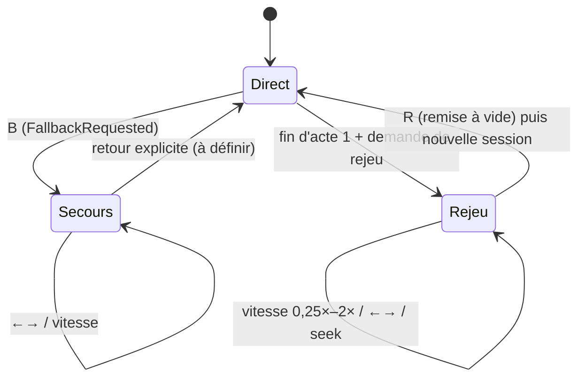

# Journal de session, rejeu et mode secours

**En bref.** Chaque session écrit un **journal horodaté** de tout ce qui atteint l'écran (transcript, états de l'orbe, activité des agents, messages A2UI bruts, actions). Le lecteur de rejeu réinjecte ce journal dans le **même port** `SessionEventSource` que le direct : le canevas se reconstruit à l'identique, sans réseau. C'est à la fois la fonction « Rejouer » (acte 4, FR-09) et le **mode secours** (FR-10, NFR-07), exigence Must ([pdr-0006](../decisions/pdr-0006-replay-fallback-must.md)).

> Statut : **draft**. Conception proposée par l'assistant.

## Exigences portées

| Exigence | Contrainte | Mécanisme |
|---|---|---|
| FR-09 | toute la génération enregistrée, rejouable de 0,25× à 2× | journal JSONL + horloge virtuelle à vitesse variable |
| FR-10 | un raccourci bascule en mode secours | raccourci `B` (proposé, E5) → `FallbackRequested` |
| NFR-07 | bascule < 2 s, sans redémarrer l'app | session de secours déjà chargée en mémoire ; changement de source, pas de redémarrage |
| NFR-08 | données figées, seule la composition varie | jeu de données figé derrière les agents + snapshot de leurs réponses |
| NFR-02, NFR-03 | mesure par « horodatage du journal A2UI » | horodatages monotones relatifs au début de session |
| Acte 4 | rejeu au ralenti, synchronisé avec le JSON | le panneau protocole lit les mêmes entrées que le canevas |

## Format du journal (proposition)

En-tête (1re ligne) : `schema`, version de l'app, `catalogId`, version A2UI (valeur de `a2ui.version`, `v0.9` ⚠️ selon Q-03 / E3), version du jeu de données, date, profil (répétition / direct).

Une ligne JSON par événement :

| Champ | Contenu |
|---|---|
| `seq` | numéro d'ordre strict (l'ordre A2UI est obligatoire, [genui-a2ui-messages]) |
| `t_ms` | temps depuis le début de session (horloge monotone) |
| `kind` | `transcript`, `orb`, `agent`, `a2ui`, `action`, `marker` |
| `payload` | message A2UI **brut** tel que reçu, ou événement normalisé (`TranscriptSegment{role, text, startMs, final}`, [rt-transcription]) |
| `corr` | `delegation_id`, révision de tâche, `surfaceId`, id de composant (sert au lien protocole ↔ composant, FR-05) |

Les `marker` balisent la fin de phrase du speaker et le début de chaque acte : ils servent au calcul de NFR-02/NFR-03.

## Où enregistrer

| Journal | Rôle | Proposition |
|---|---|---|
| Client | source du rejeu et du mode secours (doit marcher **sans réseau**) | **canonique** |
| Backend (`session-recorder`) | mesure des latences côté serveur, diagnostic, snapshots d'agents | complémentaire |

## Lecteur de rejeu

- **Horloge virtuelle** : les événements sont réémis à `t_ms / vitesse`.
- **Seek arrière** : l'A2UI est incrémental ; on remet le canevas à vide (nouvelle portée `SurfaceController`) puis on rejoue instantanément jusqu'à la position ([genui-multiple-surfaces]).
- **←/→** : pas d'un événement A2UI (proposition), synchronisé avec la mise en évidence du panneau protocole.
- **Indicateur discret** dans un coin en mode secours (fiche §6, état « Secours » de l'orbe).

## Bascule en mode secours (< 2 s)

1. `FallbackRequested` (raccourci).
2. La session voix est **arrêtée** (`stop`, pas `dispose`) avec un timeout de garde, sans bloquer la bascule ([rt-graceful-close]).
3. Le port `SessionEventSource` passe sur `ReplaySessionSource` avec la **session de référence** préchargée au démarrage.
4. Le canevas est remis à vide puis rejoué ; l'indicateur « Secours » s'affiche.

La session de référence est un journal de répétition **choisi et committé** (fixture), embarqué avec l'app. Cela suppose une persistance au-delà de la session, alors que la fiche l'exclut du périmètre (écart **E18**, [Q-36](../roadmap/open-questions.md) et [Q-50](../roadmap/open-questions.md)).

## Déterminisme

- Les agents ne lisent que le jeu de données figé ([pdr-0005](../decisions/pdr-0005-frozen-fictional-dataset.md), [p-fn-dataset](../functional/dataset.md)).
- Les réponses d'agents sont **snapshotées** par acte (mesure de NFR-08) et comparées en CI.
- Le rejeu est déterministe par construction : il n'appelle ni LLM ni réseau.

## Réutilisations du journal

| Usage | Comment | Source |
|---|---|---|
| Tests BDD et widget | fake de transport qui rejoue un journal (frontière réseau) | [test-mock-boundaries-only] |
| Widgetbook | scénarios `CachedSurface` par payload A2UI enregistré : quelques messages A2UI réels en fixtures JSON versionnées, un scénario par payload, sans réseau ni LLM dans le catalogue (origine : knowledge [ds-widgetbook-4-genui], transféré le 2026-10-28 ; usage « démo du talk » : [frontend.md](frontend.md)) | [ds-widgetbook-4-genui] |
| Mesure des NFR | script qui calcule p90 sur 10 répétitions | [p-ar-quality](quality.md), [ma-voice-agent-evals] |

## Données personnelles

Le journal contient le transcript du speaker, pas l'audio (par défaut, ne pas enregistrer l'audio : [ma-otel-genai-spans]). Pas de secret dans les payloads ([p-ar-security](security.md)).

## Points ouverts (registre : [p-rm-open-questions](../roadmap/open-questions.md))

- **Voix en rejeu** : rejeu muet commenté par le speaker, ou audio de l'IA enregistré et rejoué (nécessite une capture de la sortie et un format) → Q-18.
- **Session de référence** : laquelle, enregistrée quand, rafraîchie à chaque changement de catalogue ou de jeu de données → Q-50, Q-36.
- **Détection automatique** de perte réseau pour proposer la bascule, ou bascule uniquement manuelle (fiche : raccourci) → Q-51.
- **Sortie du mode secours** et retour au direct pendant le talk → Q-51.
- **Pas de ←/→** : un événement A2UI, une surface, ou un pas de temps → Q-52.
