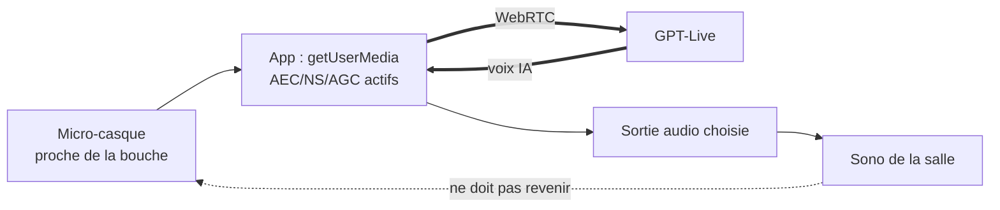

# Environnement de scène et répétitions

**En bref.** Le risque principal est **scénique** : démo vocale en direct sur le réseau d'une conférence (fiche §8). Cette page décrit la machine de démo, le réseau, la chaîne audio jusqu'à la sono et le protocole de répétition qui valide la Definition of Done.

> Statut : **draft**. Les éléments matériels sont des hypothèses tant que la salle et la machine ne sont pas connues.

## Machine de démo

| Élément | Valeur | Statut / source |
|---|---|---|
| OS | macOS prioritaire, Windows en secours | [pdr-0002](../decisions/pdr-0002-desktop-platform.md) ; ⚠️ Hypothèse non confirmée : OS réel de la machine (E5, Q-07) |
| Version d'OS | macOS ≥ 12 exigé par Flutter 3.47 ; Mac Intel en fin de support | [perf-desktop-specifics] |
| Rendu | Impeller (Metal sur macOS, Vulkan sur Windows) par défaut | [perf-desktop-specifics] |
| Sortie vidéo | projection 1920×1080, 16:9 | fiche §1 |
| Permissions macOS | `NSMicrophoneUsageDescription`, entitlements `device.audio-input` et `network.client` (Debug **et** Release) | [rt-flutter-webrtc-permissions] |
| Secours Windows | `genui` ne liste pas Windows sur pub.dev : à valider par le spike SP-09 avant de compter dessus (Q-45) | [genui-overview], [p-rm-spikes](../roadmap/spikes.md) |

## Réseau

| Mesure | Origine |
|---|---|
| Connexion mobile dédiée, jamais le Wi-Fi de la salle | fiche §8 |
| Mode secours en un raccourci, sans réseau | FR-10, NFR-07 ; [p-ar-replay](replay.md) |
| 2 des 10 répétitions de validation sur réseau mobile | fiche §8 (DoD) |
| WebRTC (UDP) pour la voix ; HTTPS + WSS vers le backend | [rt-latency], [p-ar-agents-protocols](agents-protocols.md) |

L'emplacement du backend (machine de démo ou cloud) change la dépendance réseau : en local, seuls GPT-Live et le LLM texte passent par la connexion mobile (voir Points ouverts).

## Chaîne audio

| Règle | Source |
|---|---|
| Micro-casque proche de la bouche ; voix de l'IA envoyée à la sono **sans repasser par le micro** ; test sur place | fiche §8 |
| Une seule capture : `getUserMedia` de `flutter_webrtc`, contraintes `echoCancellation`, `noiseSuppression`, `autoGainControl` | [rt-echo-cancellation] |
| Ne jamais activer `bypassVoiceProcessing` (casse l'AEC) | [rt-echo-cancellation] |
| Choix de la sortie audio : `selectAudioOutput(deviceId)` disponible sur macOS et Windows | [rt-flutter-webrtc-audio-routing] |
| Bruits courts (rires, applaudissements) : seuil réglé en répétition ; raccourci « silence » en secours | fiche §8 ; FR-18, FR-20 |

## Régie clavier

- Raccourcis proposés (fiche §6, à valider, E5) : Espace, M, P, R, B, ←/→.
- Le focus doit rester dans l'arbre des `Shortcuts` (sinon les touches sont perdues) ; aucun champ texte dans l'écran, donc touches nues possibles ([ux-desktop-shortcuts], [ux-desktop-focus]).
- Toutes les actions critiques ont un raccourci (NFR-12).

## Avant le talk (checklist proposée)

1. Build depuis le dépôt et le `pubspec.lock` sur la machine de démo (NFR-10).
2. Permissions micro accordées ; sortie audio vers la sono vérifiée.
3. Backend démarré ; clé et plafonds de coût vérifiés ([p-ar-security](security.md)).
4. Session de référence de secours chargée ([p-ar-replay](replay.md)).
5. Session voix ouverte **juste avant** la démo (15 s facturées à l'initialisation, [rt-gpt-live-overview]) et pré-chauffage WebRTC ([rt-latency]).
6. Test de coupure de parole avec la sono allumée.

## Protocole de répétition (fiche §8)

| Critère | Seuil |
|---|---|
| Répétitions complètes consécutives sans intervention manuelle | 10, dont 2 sur réseau mobile |
| NFR-01 à NFR-03 | tenus au p90 sur ces 10 répétitions |
| Bascule secours Wi-Fi coupé | < 2 s |
| Coupure de parole, sono allumée | 10/10, sans interruption spontanée de l'IA |
| Lisibilité | validée depuis le fond d'une salle réelle ou équivalente |
| Répétition générale | ≥ 3 développeurs Flutter savent réexpliquer le rôle du catalogue en une phrase |

Chaque répétition produit un journal ; le script de mesure calcule les p90 ([p-ar-quality](quality.md)).

## Points ouverts (registre : [p-rm-open-questions](../roadmap/open-questions.md))

- **OS et modèle** de la machine de démo (E5) → Q-07.
- **Emplacement du backend** pendant le talk (local ou cloud) → Q-15.
- **Durée maximale** d'une session GPT-Live : non documentée ([rt-gpt-live-overview]) ; ouvrir une session par acte ou une seule pour la démo → Q-53.
- **Matériel audio** (micro-casque, interface, retour) et accès à la régie son de la salle → Q-57.
- **Durée du talk** et du créneau de démo (8 à 10 min, hypothèse de la fiche, E5) → Q-06.
