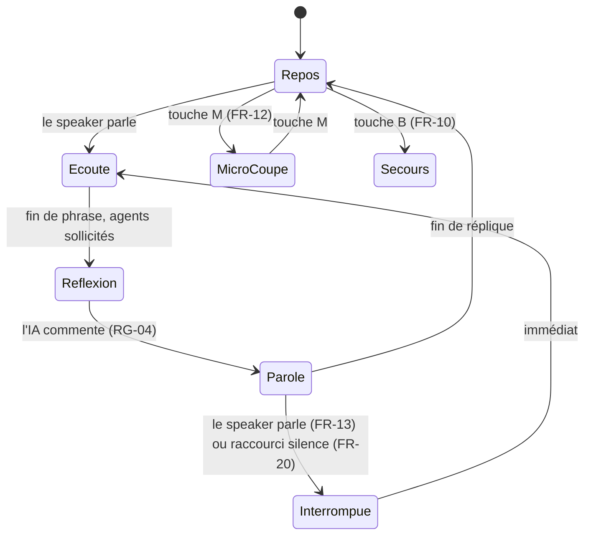

# Écran unique « Genesis Canvas »

**En bref.** Un seul écran, projeté en 16:9 (1920×1080), montre en même temps le **résultat** (le canevas) et sa **fabrication** (agents, protocole, catalogue). Six zones, sept états de l'orbe vocal, trois modes d'interaction (fiche § 6, p. 7-10). Décision : [pdr-0008](../decisions/pdr-0008-single-screen-show-the-making.md).

Un pointillé relie le message en cours dans le flux du protocole au composant qu'il construit dans le canevas (fiche § 6, légende de la maquette fonctionnelle).

## Les 6 zones (fiche § 6)

| Zone | Ce qu'elle montre | Comportement | FR |
|---|---|---|---|
| **Barre supérieure** | Orbe vocal, transcription de la conversation, forme d'onde | Les répliques du speaker et de l'IA s'affichent en direct ; une réplique coupée est tronquée | FR-02, FR-19 |
| **Canevas génératif** | Les surfaces générées (6 au maximum) | Vide au départ ; chaque surface passe par squelette, composants, données ; une modification transforme sur place | FR-01, FR-04, FR-07 |
| **Rail des agents** | L'orchestrateur et les 3 agents spécialisés | Un agent s'allume quand il est sollicité, avec sa tâche ; une liaison animée montre la délégation | FR-03 |
| **Flux du protocole** | Les messages d'interface envoyés par les agents | Replié par défaut, déplié à la demande ; le message en cours est mis en évidence et relié à son composant | FR-05 |
| **Étagère du catalogue** | Les 8 composants disponibles | Le composant choisi par l'agent s'allume au moment où il est utilisé | FR-06 |
| **Rejeu** | Un curseur sur l'historique de la session | Rejoue la construction au ralenti ou en accéléré ; sert aussi de mode secours | FR-09, FR-10 |

Libellés vus dans les maquettes : « AGENTS A2A » (rail), « FLUX A2UI · live » (flux), « CATALOGUE · n / 6 utilisés » (étagère), « CANEVAS · release-3-4 ». La zone Rejeu n'apparaît sur aucune maquette (écart E13 · Q-31, [p-fn-mockups](mockups.md)).

## États de l'orbe vocal (fiche § 6, p. 9)

| État | Signification | Rendu visuel |
|---|---|---|
| Repos | Session ouverte, personne ne parle | Pulsation lente |
| Écoute | Le speaker parle | L'orbe suit le volume de la voix |
| Réflexion | Les agents travaillent | Rotation, agents allumés dans le rail |
| Parole | L'IA parle | L'orbe suit la voix de l'IA |
| Interrompue | Le speaker vient de couper l'IA | Arrêt net, bref flash, retour à « Écoute » |
| Micro coupé | Le speaker a coupé son micro | Orbe grisé barré |
| Secours | Rejeu d'une session enregistrée | Indicateur discret dans un coin |

Transitions déduites de la fiche (synthèse de l'assistant, à relire) :

⚠️ Les maquettes affichent la pastille « EN ÉCOUTE » pendant la planification et la construction, là où la fiche prévoit « Réflexion » (écart E12 · Q-30). Repères : [ux-voice-multimodal], [rt-barge-in].

## Modes d'interaction (fiche § 6, p. 9)

| Mode | Usage | Qui |
|---|---|---|
| **Voix** (principal) | Demander, modifier, corriger, couper la parole à l'IA | Speaker |
| **Clic sur un composant généré** | La réponse de l'agent arrive à la voix et dans l'interface | Speaker |
| **Clavier** | Régie de scène (raccourcis ci-dessous) | Réservé au speaker |

## Raccourcis clavier proposés (fiche § 6, p. 10)

⚠️ **Hypothèse non confirmée** : la fiche les dit « proposés, à valider » (écart E5 · Q-05, [p-rm-open-questions](../roadmap/open-questions.md)).

| Touche | Action | Exigence |
|---|---|---|
| Espace | Faire taire l'IA | FR-20 |
| M | Couper ou rétablir le micro | FR-12 |
| P | Déplier ou replier le flux du protocole | FR-05 (zone flux) |
| R | Remettre le canevas à vide | FR-11 |
| B | Basculer en mode secours | FR-10 |
| ← / → | Reculer ou avancer dans le rejeu | FR-09 |

Points d'attention pour la validation (assistant, non décidés) :
- Sur desktop, Espace active aussi le bouton qui a le focus (par exemple « Bloquer la release ») ; un raccourci Flutter ne se déclenche que dans le sous-arbre focalisé ([ux-desktop-shortcuts], [ux-desktop-focus]).
- NFR-12 exige un raccourci pour **toutes** les actions critiques : la liste devra être revue en répétition ([p-fn-risks-acceptance](risks-acceptance.md)).

## Barre supérieure : transcription

La transcription affiche les deux voix en direct ; la réplique de l'IA coupée est tronquée à l'endroit de l'interruption (FR-19). Sources de transcription par fournisseur : [rt-transcription].
