# Écran unique « Genesis Canvas »

**En bref.** Un seul écran, projeté en 16:9 (1920×1080), montre en même temps le **résultat** (le canevas) et sa **fabrication** (agents, protocole, catalogue). Six zones, sept états de l'orbe vocal, trois modes d'interaction (fiche § 6, p. 7-10). Décision : [pdr-0008](../decisions/pdr-0008-single-screen-show-the-making.md).

Un pointillé relie le message en cours dans le flux du protocole au composant qu'il construit dans le canevas (fiche § 6, légende de la maquette fonctionnelle).

## Les 6 zones (fiche § 6)

| Zone | Ce qu'elle montre | Comportement | FR |
|---|---|---|---|
| **Barre supérieure** | Orbe vocal, transcription de la conversation, forme d'onde | Les répliques du speaker et de l'IA s'affichent en direct ; une réplique coupée est tronquée | FR-02, FR-19 |
| **Canevas génératif** | Les surfaces générées (6 au maximum) | Vide au départ ; chaque surface passe par squelette, composants, données ; une modification transforme sur place | FR-01, FR-04, FR-07 |
| **Rail des agents** | L'orchestrateur et les 3 agents spécialisés | Un agent s'allume quand il est sollicité, avec sa tâche ; une liaison animée montre la délégation (livrée par 015) | FR-03 |
| **Flux du protocole** | Les messages d'interface envoyés par les agents | Replié par défaut, déplié à la demande ; le message en cours est mis en évidence et relié à son composant | FR-05 |
| **Étagère du catalogue** | Les 6 composants disponibles ([pdr-0014](../decisions/pdr-0014-six-component-catalog.md)) | Le composant choisi par l'agent s'allume au moment où il est utilisé | FR-06 |
| **Rejeu** | Un curseur sur l'historique de la session | Rejoue la construction au ralenti ou en accéléré ; sert aussi de mode secours | FR-09, FR-10 — mode secours retiré ([pdr-0032](../decisions/pdr-0032-obs-video-fallback-a2ui-replay-act.md)) : la zone sert l'acte 4 (flux A2UI seul) |

Libellés vus dans les maquettes : « AGENTS A2A » (rail), « FLUX A2UI · live » (flux), « CATALOGUE · n / 6 utilisés » (étagère), « CANEVAS · release-3-4 » (non repris : aucun budget de hauteur ni donnée de release dans les messages, [pdr-0075](../decisions/pdr-0075-013-design-ergonomics-details-assistant-decided.md) D1). La zone Rejeu n'apparaît sur aucune maquette (écart E13 · Q-31, [p-fn-mockups](mockups.md)).

## Les six zones telles que livrées (007, 2026-10-30)

Fiche muette sur les détails d'interface : tranchés par la boucle sous [pdr-0062](../decisions/pdr-0062-standing-rule-sheet-wins-assistant-decides-ui-details.md), contestables par le porteur ([pdr-0063](../decisions/pdr-0063-007-stage-ui-details-assistant-decided.md)). Implémentation : [p-ar-frontend-screen](../architecture/frontend-screen.md).

| Zone | Telle que livrée |
|---|---|
| **Barre supérieure** (+ régie) | orbe, transcription, bouton Démarrer ; **indicateur d'acte** « Acte n/3 · Créer / Transformer / Interagir » (D1) et bouton **« Remettre à vide »** (D4) empilés dans la barre, sans zone « régie » séparée (**deux contrôles de 48 px et de 520 px de large depuis 013**, aux couleurs du thème de scène ; **régie à deux colonnes de 480 px depuis 014**, voir § Régie 014) ; l'indicateur vaut 1 par défaut et **avance tout seul depuis 011** ([pdr-0071](../decisions/pdr-0071-act2-focus-memory-act-indicator-click-feedback.md)) : acte 2 quand la Barre d'actions apparaît, acte 3 au clic accepté, jamais en arrière, sans effet en rejeu ; un clic manuel passe à l'acte suivant pour corriger (souris d'abord) ; retour à 1 à la remise à vide ; le bouton est inactif tant qu'un agent travaille ou attend |
| **Rail des agents** | **rangée horizontale de 96 px depuis 013**, de hauteur fixe même vide ; piloté par le message `plan` (D5, RG-29) : l'orchestrateur, puis les agents du plan, sans nom codé en dur ; états en toutes lettres (« en attente », « en cours », « terminé », « échec », « hors périmètre ») ; un agent non retenu est **« en veille »** ; plan vide : **« aucun agent retenu »** (RG-08) ; rail vide (titre « AGENTS A2A » seul) tant qu'aucun `plan` n'est arrivé (RG-01) |
| **Canevas** | surfaces au rang du contrat (indicateur clé, courbe, avis, checklist), grille **2×2 jusqu'à 4 surfaces, 3×2 dès la cinquième** (6 surfaces au plus ; la liste des crashs, 012, est la cinquième cellule, [p-fn-catalog](catalog.md)) ; **bandeau de 72 px sous la grille** pour la Barre d'actions (009, pdr-0065 D7), réservé dès la première surface ; **contour pointillé** autour de la surface du message en cours (D2) ; cellules **624×302** (3×2) ou **936×302** (2×2) depuis 013, sans libellé tronqué |
| **Flux du protocole** | **replié en bas à droite** ; déplié (clic), il recouvre le canevas à droite **sans le redimensionner** (hauteur min(620 px, place disponible), nombre d'entrées calculé sur la hauteur, depuis 013) ; message en cours mis en évidence, messages refusés marqués « refusé » ; JSON affiché brut |
| **Étagère** | « CATALOGUE · n / 6 utilisés » (**deux rangées de trois puces à noms entiers**, état par icône et `Semantics`, depuis 013) ; « 4 / 6 » en fin d'acte 1, **« 5 / 6 »** quand la Barre d'actions apparaît (fin de l'acte 2, 009) **ou** quand la liste des crashs est demandée (012, « 6 / 6 » avec les deux) ; Liste des crashs « inutilisée » tant qu'elle n'a pas été demandée (FR-06) |
| **Rejeu** | **zone active depuis 010** (voir ci-dessous) ; emplacement « REJEU » aux commandes inactives en 007 (D3) |

D6 : composants au seul thème de scène (RG-09), statuts par codes fermés `ok|risk|blocking`, courbe dessinée sans nouvelle dépendance.

**Budget des zones à 1920×1080** (009 : [pdr-0065](../decisions/pdr-0065-009-act3-interact-details-assistant-decided.md) D8 ; **refait par 013**, [pdr-0075](../decisions/pdr-0075-013-design-ergonomics-details-assistant-decided.md) D1) : barre supérieure **128 px** (160 en 007), rail **96 px** (200 jusqu'à 012), canevas **676 px** (572 jusqu'à 012, 520 en 007) = grille 2×**302** + bandeau de la Barre d'actions de 72 px ; cellules **936×302** en 2×2 et **624×302** en 3×2 (≈ 940×250 et ≈ 620×250 jusqu'à 012), rangée du bas ≤ 140 px (étagère **900 px**, Rejeu **480 px** depuis 010, panneau replié 460 px), marges et intervalles **40 px** au total à la verticale (1080 − 128 − 96 − 140 − 40 = 676) ; texte ≥ 24 px partout (NFR-05), aucun défilement ni mise à l'échelle. ⚠️ **Limite assumée** : l'écran suppose 1920×1080 (la fenêtre Linux s'ouvre à cette taille) ; en dessous, les zones débordent ; projection 16:9 en 1080p de la machine de démo ([pdr-0028](../decisions/pdr-0028-linux-demo-machine.md)).

**À valider par le porteur** (détail d'interface tranché par la boucle sous pdr-0062, contestable) : le bandeau étant réservé dès la première surface, **une bande réservée de 72 px reste en bas du canevas pendant les actes 1 et 2** (la bande vide d'environ 220 px sous la barre du haut, due au rail fixe de 200 px, est supprimée par 013). C'est le prix d'une grille qui ne bouge pas quand la barre arrive (S-02 : « les surfaces existantes restent à leur place »). Une grille 3×2 évitait la bande mais déplaçait les quatre surfaces ; seul le porteur peut assouplir S-02. Les couleurs de bordure des deux boutons sont aussi un choix de la boucle (contrastes mesurés).

## Design et ergonomie (013, 2026-10-31)

Périmètre du porteur ([pdr-0072](../decisions/pdr-0072-design-ergonomics-013.md)) ; détails d'interface tranchés par la boucle sous pdr-0062 ([pdr-0075](../decisions/pdr-0075-013-design-ergonomics-details-assistant-decided.md) D1 à D5, **contestables**). Scénarios : [p-fn-feature-design-ergonomics-013](features/design-ergonomie-013.feature) (D-01 à D-07). Implémentation : [p-ar-frontend-screen](../architecture/frontend-screen.md) § Design et ergonomie.

| Sujet | Livré |
|---|---|
| Rail | rangée de **96 px** à hauteur fixe même vide : « AGENTS A2A » en colonne de tête, tuiles « nom » puis « état · tâche » (texte ≥ 24 px) ; intervalle de **48 px** entre l'orchestrateur et les agents ; **liaison animée de délégation livrée par 015** (FR-03, [Q-85](../roadmap/open-questions.md) tranchée → [pdr-0077](../decisions/pdr-0077-011b-overlap-interrupt-delegation-link.md) : « Oui, maintenant ») : trait pointillé animé (période 1200 ms) du bord de la tuile de l'orchestrateur à chaque tuile d'agent « en attente » ou « en cours », en arc au-dessus des pastilles (16,8 px libres, aucun libellé couvert), 3 px, couleur accent du thème ; disparaît dès que l'agent est « terminé », « échec », « hors périmètre » ou « interrompu » ; fixe sous animations coupées (`SceneMotionScope.disabled`) ; aucun libellé ajouté (scénarios L-01 à L-04 : [p-fn-feature-chevauchement-liaison-015](features/chevauchement-liaison-015.feature)) |
| Lisibilité ([Q-83](../roadmap/open-questions.md) → pdr-0075 D2) | libellés de checklist et titres à la ligne (capacité calculée sur la hauteur réelle du texte, tableau ou deux lignes, « + N autres critères ») ; avis = extraits entiers puis « + N avis » ; titre de courbe sur sa ligne, légende dessous ; étagère à noms entiers (le mot « utilisé / inutilisé » n'est plus écrit, il est annoncé par `Semantics`) ; seule la ligne d'un crash garde l'ellipse ([pdr-0074](../decisions/pdr-0074-012-llm-composer-gateway-crashlist-details.md) D10) |
| Apparition (FR-04, NFR-04, D3) | fondu squelette → composants de **200 ms** avec translation de **8 px**, fondu des valeurs de **150 ms** (seul passage « sans données » → « données », jamais rejoué par une mutation) ; durée nulle si les animations du système sont désactivées, en mode scénario ou en capture ; divisée par la vitesse en rejeu (plancher 60 ms) ; le squelette part aussitôt (pas de fondu croisé) ; une surface présente au premier rendu s'affiche sans fondu ; aucune surface ne change de taille ni de place (S-02) |
| Régie | indicateur d'acte et « Remettre à vide » **empilés**, 520 px × 48 px chacun, bordure et couleurs du thème de scène (détail tranché sous pdr-0062) ; **refaite par 014** (§ Régie 014) |
| Contrastes | texte ≥ 24 px et contraste AA vérifiés par tests et captures 1920×1080 (NFR-05) ; **mesure sur projecteur à J7**, gérée par le porteur |

⚠️ **À juger par le porteur sur la capture** (détail contestable, pdr-0075 « Réexaminer si » ; observation rattachée à [Q-83](../roadmap/open-questions.md)) : en 3×2 avec les données de l'acte 2, la checklist n'affiche que 2 critères puis « + 1 autres critères » (« Changelog validé » masqué), un seul avis tient (« + 2 avis ») et la sixième cellule reste vide. La maquette (rail en colonne) n'est pas suivie ([pdr-0017](../decisions/pdr-0017-source-hierarchy-sheet-over-mockups.md)).

## Régie : micro coupé et faire taire (014, 2026-10-31)

FR-12 et FR-20 livrées ; la fiche est muette sur la disposition : détails tranchés par la boucle sous pdr-0062 ([pdr-0076](../decisions/pdr-0076-014-silence-mic-correction-assistant-decided.md) D1 à D6, **contestables**). Scénarios : S-09, M-01, M-02 ([p-fn-feature-silence-micro-correction-014](features/silence-micro-correction-014.feature)). Implémentation : [p-ar-frontend-screen](../architecture/frontend-screen.md) § 014.

| Élément | Livré |
|---|---|
| Disposition | **deux colonnes de 480 px** (968 px au total ; la colonne unique de 013 occupait déjà 100 des 104 px de hauteur de la barre du haut, d'où une seconde colonne plutôt qu'une troisième ligne) ; gauche : « Couper le micro » / « Rétablir le micro » (`mic-button`) puis « Faire taire » (`silence-button`) ; droite : indicateur d'acte puis « Remettre à vide » ; cibles ≥ 48 px, libellés à 24 px sans ellipse (capture 1920×1080 relue) ; réplique de l'IA limitée à **une ligne** quand un message d'état est affiché (deux lignes sinon) ; raccourcis `M` et `Échap` : § Raccourcis |
| Faire taire | actif quand la session est ouverte et que l'orbe n'est pas déjà « Interrompue » (idempotent) ; coupe la piste distante, orbe « Interrompue » puis « Écoute », réplique de l'IA tronquée ; **ne ferme pas la session, n'annule aucune génération** (« Stop » vocal le fait), n'écrit rien au backend |
| Micro coupé | actif tant qu'une session est ouverte ; désactive la piste locale (la capture continue) ; micro réarmé à chaque démarrage |

⚠️ **À valider en répétition** : (1) si l'IA marque une pause d'au moins `GENESIS_INTERRUPT_RESUME_SILENCE_MS` après « Faire taire », sa voix revient au milieu de la réplique (la génération n'est pas annulée) ; (2) coupure audible de la piste, distante ou locale, sous `flutter_webrtc` Linux (Q-79) ; (3) lisibilité de la réplique à une ligne.

## Zone Rejeu et acte 4 (010, 2026-10-30)

FR-09 livrée ; la fiche ne détaille pas les commandes : détails tranchés par la boucle sous pdr-0062 ([pdr-0066](../decisions/pdr-0066-010-act4-replay-details-assistant-decided.md) D1 à D8, contestables). Mécanisme : [p-ar-replay](../architecture/replay.md) ; implémentation : [p-ar-frontend-screen](../architecture/frontend-screen.md) § Acte 4.

| Élément | Comportement |
|---|---|
| Disposition | zone de **480 px** à 1920×1080, **deux rangées de 48 px** (étagère ramenée de 1040 à 900 px) : rangée 1 « REJEU », Lecture/Pause (un bouton), Recommencer, curseur, « Direct » ; rangée 2 : vitesses 0,25×, 0,5×, 1×, 1,5×, 2× (1× par défaut, la vitesse choisie est gardée par Recommencer) |
| Entrée | « Lecture » : sans appel backend ; inactif sans surface créée au journal, pendant qu'un agent travaille ou qu'une action est en cours |
| Indicateur d'acte | « Acte 4 · Rejeu » (texte seul, non cliquable) pendant le rejeu |
| En rejeu | le canevas se vide puis se reconstruit comme en direct ; le panneau du protocole suit le message rejoué et reste déplié pendant un positionnement (FR-05) ; « Démarrer » et les boutons du canevas sont inactifs ; la session voix n'est pas touchée ; les messages A2UI vivants sont écartés |
| Curseur | couvre la durée comprimée (silence plafonné à 3 s entre deux messages) ; un seul positionnement au relâchement |
| Sortie | « Direct » (toujours actif) ou « Remettre à vide » : remise à vide complète, journal vidé |

⚠️ **À voir avec le porteur en répétition** (détails d'interface tranchés par la boucle, rien n'est décidé par le porteur) : le titre du panneau reste « FLUX A2UI · live » pendant le rejeu (cosmétique) ; le rail des agents est dit vide pendant le rejeu (seul le flux A2UI est rejoué, pdr-0032), mais l'écran garde les tuiles terminées d'un direct (écart porté par [Q-88](../roadmap/open-questions.md), non tranché ; aucune liaison en rejeu, L-04) ; plafond d'écart de 3 s ; place de la zone Rejeu dans la rangée du bas. Hors périmètre de 010, traités par 013 ([pdr-0072](../decisions/pdr-0072-design-ergonomics-013.md)) : boutons d'acte et de remise à vide à 44 px (désormais 48 px) ; le débordement de 39 px du panneau déplié n'est pas reproduit à la mise en page actuelle (panneau borné, testé avec 4 entrées dont une refusée et `actions`).

## États de l'orbe vocal (fiche § 6, p. 9)

| État | Signification | Rendu visuel |
|---|---|---|
| Repos | Session ouverte, personne ne parle | Pulsation lente |
| Écoute | Le speaker parle | L'orbe suit le volume de la voix |
| Réflexion | Les agents travaillent | Rotation, agents allumés dans le rail |
| Parole | L'IA parle | L'orbe suit la voix de l'IA |
| Interrompue | Le speaker vient de couper l'IA | Arrêt net, bref flash, retour à « Écoute » ; **livré par 011** sur « Stop » (orbe à niveau 0, son distant coupé, réplique tronquée) ; **014** : aussi par « Faire taire » (bouton, `Échap`) et sur une correction en vol |
| Micro coupé | Le speaker a coupé son micro | Orbe grisé barré ; **livré par 014** comme un **voile** (disque grisé barré de 64 px, libellé « Micro coupé » à 24 px sous l'orbe) posé **par-dessus** la phase réelle de l'IA : ce n'est pas une phase de l'orbe, donc « Faire taire » reste possible micro coupé |
| Secours | Rejeu d'une session enregistrée | Indicateur discret dans un coin — **retiré (pdr-0032)** |

Transitions déduites de la fiche (synthèse de l'assistant, à relire) :

```mermaid
stateDiagram-v2
    [*] --> Repos
    Repos --> Ecoute : le speaker parle
    Ecoute --> Reflexion : fin de phrase, agents sollicités
    Reflexion --> Parole : l'IA commente (RG-04)
    Parole --> Interrompue : mot d'arrêt (FR-13), « Faire taire » ou Échap (FR-20), correction en vol (FR-17)
    Interrompue --> Ecoute : silence de 3 s ou 15 s au plus (011) ; correction : première délégation d'offset ≥ at_ms (014)
    Parole --> Repos : fin de réplique
```

Le micro coupé est **orthogonal** à ces phases (voile par-dessus, pas d'état de l'orbe) : bouton « Couper le micro » ou touche M (FR-12) pour le couper, bouton « Rétablir le micro » ou M pour le rétablir ; un nouveau démarrage ou une fermeture de session repartent micro actif.

⚠️ **À voir avec le porteur en répétition** (détail tranché par la boucle sous pdr-0062, la fiche ne chiffre pas la durée) : « Interrompue » est tenue jusqu'à 3 s de silence (`GENESIS_INTERRUPT_RESUME_SILENCE_MS`) ou 15 s au plus, pas seulement un flash ; la transition « immédiat » du schéma est une déduction de l'assistant. Couper la parole **sans** dire « Stop » ni mot de correction passe aussi par « Interrompue » depuis 015 (S-05 complet, Q-77 → pdr-0077) : reçue alors que l'orbe écoute déjà (le fournisseur a coupé sa voix avant notre message), l'interruption rend aussitôt « Écoute » et la piste ([p-ar-voice-overlap](../architecture/voice-overlap.md)).

L'état Secours et la transition « touche B » (FR-10) sont retirés par [pdr-0032](../decisions/pdr-0032-obs-video-fallback-a2ui-replay-act.md) : le secours est une vidéo gérée par le porteur.

⚠️ Les maquettes affichent la pastille « EN ÉCOUTE » pendant la planification et la construction, là où la fiche prévoit « Réflexion » (écart E12 · Q-30 tranché : la fiche s'applique, [pdr-0054](../decisions/pdr-0054-stage-screen-orb-acts-checklist.md)). Repères : [ux-voice-multimodal], [rt-barge-in].

## Modes d'interaction (fiche § 6, p. 9)

| Mode | Usage | Qui |
|---|---|---|
| **Voix** (principal) | Demander, modifier, corriger, couper la parole à l'IA | Speaker |
| **Clic sur un composant généré** | La réponse de l'agent arrive à la voix et dans l'interface ; livré par 009 pour la Barre d'actions ; **retour au clic fort depuis 011** : indicateur « en cours » pendant l'envoi, pastille de décision (« Bloquée » / « Validée ») visible en entier, bouton « <libellé> · fait ✓ » désactivé sans nouvelle requête, réactivé si une demande vocale réécrit la checklist (Q-76) | Speaker |
| **Clavier** | Régie de scène (raccourcis ci-dessous) | Réservé au speaker |

## Raccourcis clavier proposés (fiche § 6, p. 10)

Tranché (E5 · Q-05, [pdr-0033](../decisions/pdr-0033-optional-shortcuts-mouse-first.md)) : les raccourcis sont **facultatifs**. Toute action critique a un contrôle cliquable ; un raccourci ne s'ajoute que s'il ne pose pas de problème (focus, conflit).

| Touche | Action | Exigence |
|---|---|---|
| ~~Espace~~ → **Échap** | Faire taire l'IA | FR-20 ; **livré par 014** : `Échap` à la place d'`Espace` (écart à la fiche, [pdr-0076](../decisions/pdr-0076-014-silence-mic-correction-assistant-decided.md) D2 : sur desktop `Espace` active le bouton focalisé) ; bouton « Faire taire » d'abord (pdr-0033) |
| M | Couper ou rétablir le micro | FR-12 ; **livré par 014** (facultatif, bouton « Couper le micro » d'abord, pdr-0033) |
| P | Déplier ou replier le flux du protocole | FR-05 (zone flux) |
| R | Remettre le canevas à vide | FR-11 ; **non fourni** : bouton « Remettre à vide » (007, [pdr-0033](../decisions/pdr-0033-optional-shortcuts-mouse-first.md)) |
| ~~B~~ | ~~Basculer en mode secours~~ | ~~FR-10~~ retirée (pdr-0032) |
| ← / → | Reculer ou avancer dans le rejeu | FR-09 ; **non fourni** (010) : pas de pas-à-pas : lecture, pause et vitesse suffisent (Q-52 → [pdr-0059](../decisions/pdr-0059-acts-2-3-and-replay-simplifications.md)) |

Points d'attention (assistant) :
- Sur desktop, Espace active aussi le bouton qui a le focus (par exemple « Bloquer la release ») : c'est pourquoi 014 retient `Échap` ; un raccourci Flutter ne se déclenche que dans le sous-arbre focalisé ([ux-desktop-shortcuts], [ux-desktop-focus]).
- NFR-12 est assoupli (pdr-0033) : une action critique sans raccourci fiable reste faisable à la souris. Depuis 014, la page porte `Focus(autofocus)` + `Shortcuts`/`Actions` : `M` et `Échap` répondent sans clic préalable et après un clic sur un bouton qui se désactive ; sans effet hors session ([pdr-0076](../decisions/pdr-0076-014-silence-mic-correction-assistant-decided.md) D5).

## Barre supérieure : transcription

La transcription affiche les deux voix en direct ; la réplique de l'IA coupée est tronquée à l'endroit de l'interruption (FR-19). Sources de transcription par fournisseur : [rt-transcription].
