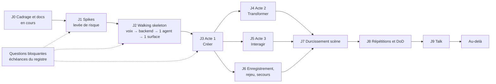

# Roadmap : de la fiche produit au talk, puis au-delà

**En bref.** Dix jalons, de J0 (cadrage, **en cours**, en attente de relecture du porteur) à J9 (le talk), puis une phase « Au-delà ». L'ordre suit la levée de risque : spikes d'abord, puis une chaîne bout en bout minimale, puis les 3 actes ([pdr-0004](../decisions/pdr-0004-mvp-three-acts.md)), le mode secours et le durcissement scénique. **Aucune date** : la date de la conférence et la durée du talk sont inconnues ([Q-06, Q-12](open-questions.md)). Les tailles sont relatives (S < M < L < XL).

## Point de départ (état du dépôt au 2026-10-28)

| Élément | État | Source |
|---|---|---|
| Base `knowledge/` (faits vérifiés, ADR adr-0001 à adr-0008) | Présente | `knowledge/index.yaml` |
| Spike Widgetbook 4.0.0-beta.14 | Fait, vérifié | [ds-widgetbook-4-spike], `spikes/widgetbook4/` |
| Fiche produit et 3 maquettes | Présentes | `product/sources/` |
| Code applicatif (app Flutter, backend Go) | **Aucun** | `git log` |

## Graphe de dépendances

J4, J5 et J6 peuvent avancer en parallèle une fois l'acte 1 stable.

## Jalons

| Jalon | Taille | Objectif | Contenu | Exigences couvertes | Critère de sortie vérifiable | Dépend de | Risques principaux |
|---|---|---|---|---|---|---|---|
| **J0** Cadrage et docs (en cours) | S | Vision fonctionnelle et technique partagée | Base `knowledge/`, ADR 0001-0008, spike Widgetbook, dossier `product/`, PDR 0001-0012 | — | Dossier `product/` relu ; `product_lint.py` sans erreur ; questions ouvertes listées | — | Écarts fiche/maquettes non tranchés (E1-E6) |
| **J1** Spikes | M | Lever les inconnues techniques avant d'écrire le produit | Spikes SP-01 à SP-07 et SP-09 (secours Windows) de [spikes.md](spikes.md) | Prépare NFR-01 à NFR-05, NFR-07, NFR-10 | Chaque spike a un résultat écrit (✅/❌/⚠️) ; faits nouveaux versés dans `knowledge/` (skill `kb-curate`) ; questions techniques tranchées ou reformulées | J0 ; Q-07, Q-45, Q-64 (levée → pdr-0026) | Versions expérimentales (genui, A2UI, `live` d'openai-go) ; résultat négatif qui remet en cause [pdr-0012](../decisions/pdr-0012-voice-provider-openai.md) |
| **J2** Walking skeleton | L | Prouver la chaîne complète, au plus mince | App Flutter desktop vide + orbe ; session voix créée par relais SDP backend (Go), aucune clé dans l'app (pas de jeton éphémère pour GPT-Live : écart de vocabulaire avec NFR-09 noté dans [pdr-0012](../decisions/pdr-0012-voice-provider-openai.md), [rt-ephemeral-keys]) ; délégation → orchestrateur → 1 agent A2A → 1 surface A2UI rendue par GenUI ; journal horodaté ; versions figées | FR-01, FR-02 (partiel), FR-04 (1 surface), NFR-09, NFR-10 ; instrumentation NFR-01/02/11 | Scénario BDD « une phrase → une surface » vert en CI (fournisseurs simulés aux frontières) **et** en réel ; aucune clé longue durée dans l'app (revue) ; `pubspec.lock` committé | J1 ; Q-03 (levée → pdr-0018), Q-09, Q-11, Q-15, Q-16, Q-25, Q-27, Q-29 (levée → pdr-0015), Q-34 (levée → pdr-0022), Q-37, Q-39, Q-43, Q-46, Q-47, Q-48, Q-54, Q-55, Q-56, Q-63 tranchées | Latence de bout en bout ; intégration `genui_a2a` (SSE) ↔ `a2a-go` |
| **J3** Acte 1 « Créer » | L | « Prépare la release 3.4 » construit le tableau | Orchestrateur + agents de l'acte 1 ; catalogue ; 4 surfaces ; rail des agents ; panneau protocole ; étagère du catalogue ; jeu de données figé ; raccourci de remise à vide ; refus à la voix d'une demande hors catalogue, avec alternative (RG-08) ; état neutre sur données incomplètes (RG-10) ; exemples d'écrans attendus fournis à l'IA (parade R6, [pdr-0023](../decisions/pdr-0023-example-guided-composition.md) ; forme des exemples : détail de conception) | FR-02, FR-03, FR-04, FR-05, FR-06, FR-11, NFR-02, NFR-03, NFR-06, NFR-08 | Scénario « Acte 1 » vert ; journal A2UI : 1er squelette < 1,5 s, 4 surfaces < 8 s (mesure indicative, p90 en J8) ; une demande hors catalogue est refusée à la voix avec une alternative (RG-08) ; un composant aux données incomplètes affiche un état neutre (RG-10) | J2 ; Q-01, Q-02, Q-04 (levée → pdr-0019), Q-08, Q-10, Q-17, Q-22, Q-23, Q-28 (levée → pdr-0020), Q-30, Q-31, Q-33 (levée → pdr-0021), Q-35, Q-38 (levée → pdr-0023), Q-44, Q-53, Q-59 (levée → pdr-0025), Q-60, Q-61 tranchées | Écran incohérent généré ; attente trop longue ; écarts E1/E2 tranchés (pdr-0013, pdr-0014) : Q-02, Q-60 levées |
| **J4** Acte 2 « Transformer » | M | Les surfaces mutent sur place | Mise à jour des composants et du data model sans recréer ; filtre plateforme ; comparaison 3.3 ↔ 3.4 ; correction en cours de génération | FR-07, FR-17 | Scénarios « Acte 2 » et « Corriger la demande » verts ; aucune surface recréée dans le journal | J3 ; Q-20, Q-21, Q-32, Q-58 (levée → pdr-0024) | Retrait de surface vu dans la maquette 3 (Q-21) ; régénération complète par le LLM |
| **J5** Acte 3 « Interagir » | M | Un clic repart vers l'agent, qui répond à la voix | Action utilisateur A2UI → orchestrateur → agent Livraison → vrai résultat → voix + mise à jour de la checklist | FR-08 | Scénario « Acte 3 » vert ; le résultat dit à la voix est le vrai résultat de l'outil ([ma-real-tool-results]) | J3 ; Q-49, Q-62 (tranchée → pdr-0016, levée) ; Q-20 (échéance J4, à trancher aussi avant J5 si J5 démarre d'abord) | Faux `{"status":"ok"}` ([proj-avw-risks]) ; focus clavier volé par le bouton (Q-05) |
| **J6** Enregistrement, rejeu, secours | M | Rejouer une session sans réseau | Enregistrement de chaque session ; curseur 0,25×-2× ; raccourci de secours ; indicateur discret | FR-09, FR-10, NFR-07 | Scénario « Bascule en mode secours » vert ; bascule Wi-Fi coupé < 2 s, sans redémarrer l'app | J3 ; Q-18, Q-36, Q-50, Q-51, Q-52 | Rejeu non déterministe ; contenu de l'enregistrement mal défini (Q-18) |
| **J7** Durcissement scène | L | Tenir en salle réelle | Barge-in, « stop », bruit court, faire-taire au clavier, micro coupé ; réglage AEC/sono ; thème de scène 24 px ; 60 i/s ; raccourcis ; script des phrases clés courtes et rodées par acte, avec réponses attendues (parade R5 de la fiche § 8) | FR-12 à FR-16, FR-18, FR-19, FR-20, NFR-01, NFR-04, NFR-05, NFR-12 | Les 5 scénarios « Couper la parole » verts ; barge-in 10/10 sono allumée ; DevTools 60 i/s ; lecture au projecteur ; checklist raccourcis complète | J4, J5, J6 ; Q-05, Q-26, Q-40, Q-41, Q-42, Q-57 | Auto-interruption par la sono ; interruptions intempestives ; texte illisible |
| **J8** Répétitions et DoD | M | Atteindre la Definition of Done de la fiche § 8 | 10 répétitions consécutives (dont 2 sur réseau mobile) ; mesures p90 ; build sur machine vierge ; répétition générale devant ≥ 3 devs Flutter | NFR-11 (plafond) ; vérification de toutes les exigences | Les 8 critères de la DoD de [p-fn-risks-acceptance](../functional/risks-acceptance.md) cochés | J7 ; Q-06, Q-13, Q-14, Q-19, Q-24 | Machine de démo non disponible ; budget de répétitions (NFR-11) |
| **J9** Talk | S | Dérouler les 3 actes en direct | Installation, test sono et projecteur sur place, démo | — | Métriques de succès de la fiche § 8 relevées (taux de réussite sans rejeu, nature des questions, feedback) | J8 ; Q-12 (échéance « au plus tôt ») | Réseau de la salle ; stress du direct |
| **Au-delà** | — | Prolonger la démo | Voir [beyond.md](beyond.md) | Hors MVP | Chaque item fait l'objet d'un PDR avant tout travail | J9 | Dérive de périmètre avant le talk |

## Règles de pilotage

1. **Pas de jalon commencé avec une question bloquante ouverte.** La source de vérité est l'**échéance** de chaque question dans [open-questions.md](open-questions.md) (« Avant Jn ») ; la colonne « Dépend de » la reprend et `product_lint.py` vérifie que chaque question « Avant Jn » y figure. Elles se tranchent via le skill `product-decide`, qui crée un PDR.
2. **TDD + BDD d'abord** : les scénarios Gherkin de [functional/features/](../functional/features/) sont écrits et rouges avant le code ([test-tdd-red-green-refactor], adr-0001 via [pdr-0011](../decisions/pdr-0011-adopt-knowledge-adrs.md)).
3. **Mesurer tôt** : le journal A2UI horodaté existe dès J2, car NFR-02 et NFR-03 se mesurent avec lui (fiche § 5).
4. **Le mode secours n'est pas un bonus** ([pdr-0006](../decisions/pdr-0006-replay-fallback-must.md)) : J6 passe avant tout raffinement visuel.
5. **Rien de l'Au-delà avant J9**, sauf décision explicite du porteur (cf. Q-10 pour l'agent tiers).

## Correspondance avec le plan backend de production

Le plan [p-rm-backend-production-plan](backend-production-plan.md) (statut `draft` ; ex-note `ma-backend-phase1-plan` de `knowledge/`, transférée le 2026-10-28) vise un produit Septeo (Keycloak, Kong, Temporal, MCP gateway). Pour la démo, seules les étapes 0 à 8 sont utiles en J1-J5 ; les étapes 9 à 12 relèvent de l'[Au-delà](beyond.md). Le périmètre exact du backend de démo reste ouvert (Q-15, Q-27).

## Phasage protocolaire d'origine

Origine : knowledge [proto-stack-recommendation] (ex-titre « Stack protocolaire (décision interne, 2026-10-27) », passages propres au projet transférés le 2026-10-28 ; la note garde la version générique). Les « phases » ci-dessous sont celles de la note d'origine, distinctes des jalons J0-J9 :

- La complexité multi-agents va dans un orchestrateur backend **dès la phase 1** (décision du 2026-10-27, [adr-0002-orchestrator-backend] ; [ma-target-architecture], [ma-where-to-run-agents]).
- **Phase 1 : orchestrateur backend minimal** : sessions voix / jetons éphémères, outil vocal unique `delegate`, agent GenUI (A2UI validé contre le catalogue), outils métier en MCP ; WebRTC app ↔ GPT-Live (`flutter_webrtc`) ou WebSocket app ↔ Gemini Live (`firebase_ai`) ; canal app ↔ backend WebSocket/SSE (ou `genui_a2a`) ; outils client locaux et sans secret uniquement ; **pas d'A2A vers des agents tiers ni d'AG-UI en phase 1**.
- **Phase 2 : ouverture** : A2A vers des agents spécialisés (SDK officiel Python, Go ou Java en v1.0) ; AG-UI (`ag_ui`) si le canal doit transporter plus que de l'A2UI ; média vocal toujours en WebRTC direct.
- **Critères de passage en phase 2** : plusieurs clients (web, mobile, desktop) partageant les agents ; secrets ou clés tierces hors de l'app ; tâches longues avec push (FCM) en arrière-plan.

⚠️ Le produit utilise des agents A2A dès le MVP (fiche § 1, [p-ar-backend](../architecture/backend.md)) alors que ce phasage d'origine les plaçait en phase 2 ; agent d'un autre éditeur : Q-10 ; vrais serveurs A2A séparés : Q-16.
